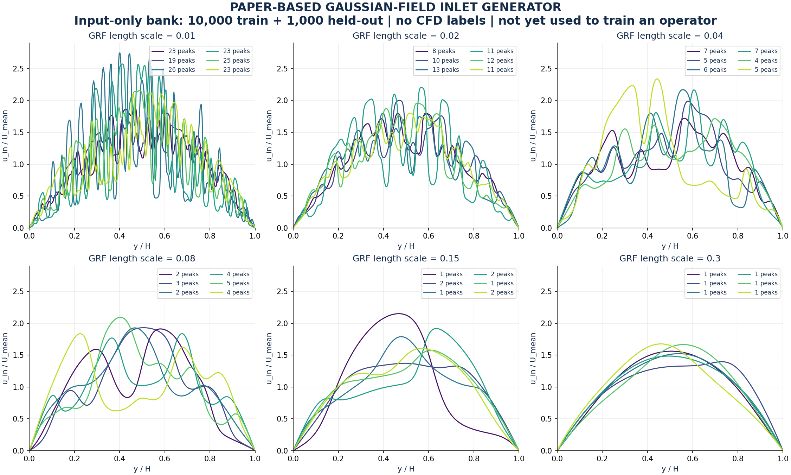
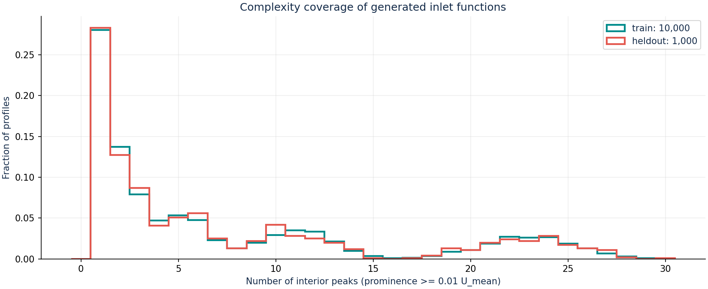

# مولد گستردهٔ ورودی بر اساس کد رسمی مقاله

**این فایل‌ها فقط ورودی‌اند؛ مدل جدیدی با آن‌ها آموزش ندیده است. وزن V2 از آن‌ها پشتیبانی نمی‌کند.**

مولد از [کد رسمی مقاله](https://github.com/PredictiveIntelligenceLab/Physics-informed-DeepONets/blob/77e7c747d653b34e79e43df7d88bad87de5c27d8/Antiderivative/PI_DeepONet_FF_antideriv.ipynb) سازگار شده است: کرنل RBF، نمونه‌گیری میدان تصادفی گاوسی با Cholesky روی ۵۱۲ نقطه و نمونه‌برداری در حسگرها.
در notebook رسمی FF مقدار `length_scale=0.01` و در مثال ساده‌تر `0.2` است؛ این نسخه از شش مقیاس (0.01, 0.02, 0.04, 0.08, 0.15, 0.3) استفاده می‌کند.
تعداد نمونه‌های این بانک، انتخاب ماست؛ عدد پیش‌فرض notebook رسمی FF در نسخهٔ بررسی‌شده ۵۰۰۰ است و مقاله برای آزمایش مربوطه ۱۰هزار گزارش می‌کند.

برای سازگاری با کانال، میدان گاوسی g به `6*y*(1-y)*(1+a*tanh(g))` تبدیل و میانگین آن یک می‌شود؛ `a` بین ۰٫۱۵ و ۰٫۷۵ است.
این تبدیلِ نامنفی، صفرکردن سرعت روی دو دیواره، محدودیت سرعت و مخلوط‌کردن مقیاس‌ها، تغییرات ما نسبت به مولد مقاله‌اند.
هیچ تصویرکردن روی چهار مود یا بریدن نوسان‌ها انجام نمی‌شود. این بازتولید داده‌های عیناً یکسان مقاله نیست، بلکه استفاده از همان روش تولید است.

| مجموعه | تعداد شکل یکتا | حسگر | بازهٔ تعداد قله | تعداد با حداقل ۹ قله |
|---|---:|---:|---:|---:|
| آموزش پیشنهادی | 10000 | 257 | [1, 30] | 3201 |
| آزمون کنارگذاشته‌شده | 1000 | 257 | [1, 30] | 317 |

قله با برجستگی حداقل ۰٫۰۱ سرعت میانگین شمرده می‌شود. هیچ پروفایل یکسانی بین دو مجموعه وجود ندارد؛ این بررسی به معنی جدایی توزیع‌ها نیست و هر دو از یک مولدند.
Re در بازهٔ ۱۰ تا ۱۰۰، سرعت نمونه‌ها نامنفی و حداکثر ۲٫۸۷۵، و میانگین ذوزنقه‌ای روی حسگرها برابر یک است.
این حدود روی نمونه‌های ذخیره‌شده کنترل شده‌اند؛ مدل آینده باید نمایش پیوسته و دقت حسگرهای آن را جداگانه بررسی کند.





- [ورودی‌های آموزش پیشنهادی](train.npz)
- [ورودی‌های آزمون مستقل](heldout.npz)
- [متادیتا و شمارش‌ها](metadata.json)
- [PDF نمونه‌ها](examples.pdf)

NPZ فقط شامل `y, profiles, reynolds, length_scales, amplitudes, rejected_speed_draws` است؛ میدان سرعت/فشار حل‌شده در آن وجود ندارد.

```bash
python scripts/prepare_broad_inlets.py
```

این مرحله فقط آماده‌سازی ورودی برای آموزش آیندهٔ یک اپراتور بدون برچسب CFD است؛ دربارهٔ همگرایی یا دقت چنین مدلی نتیجه‌ای ارائه نمی‌کند.
