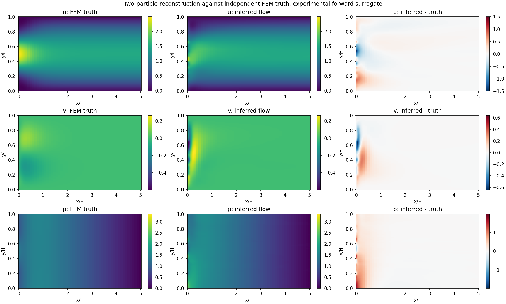
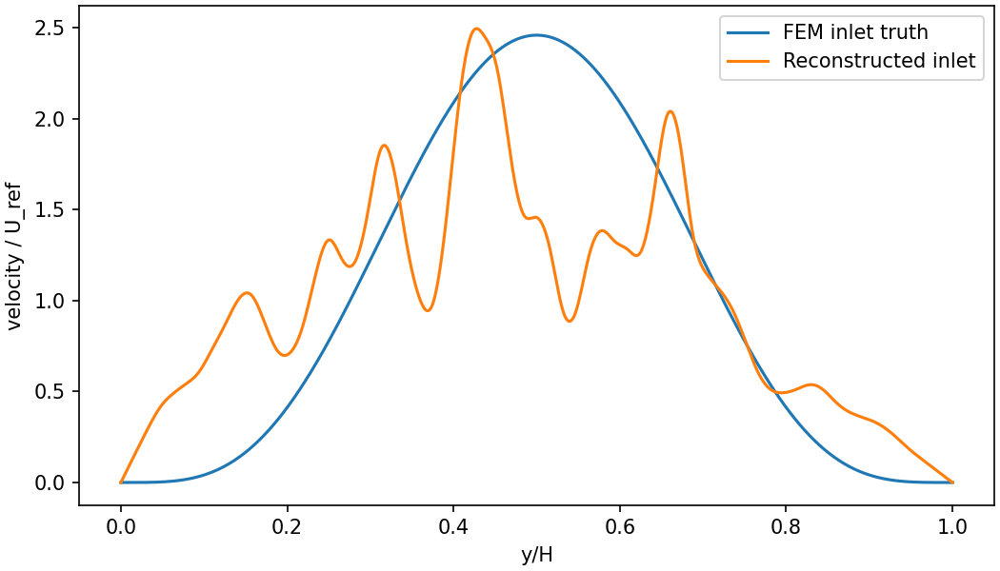
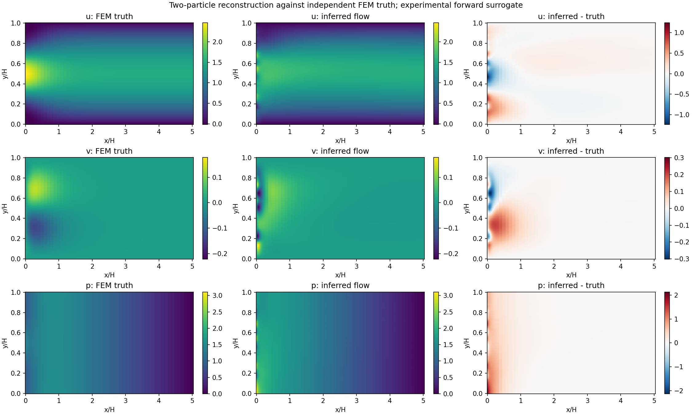
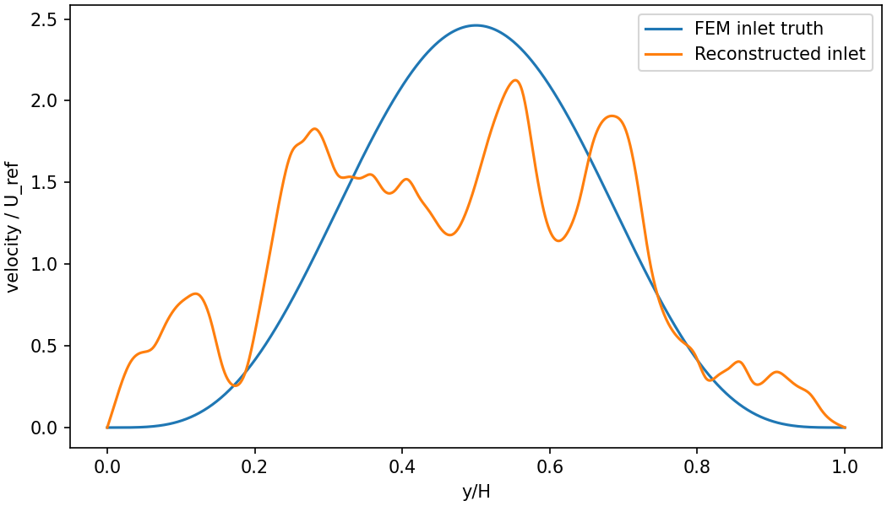
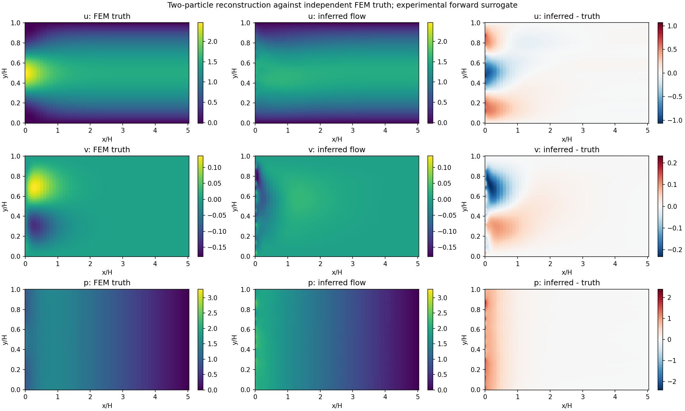
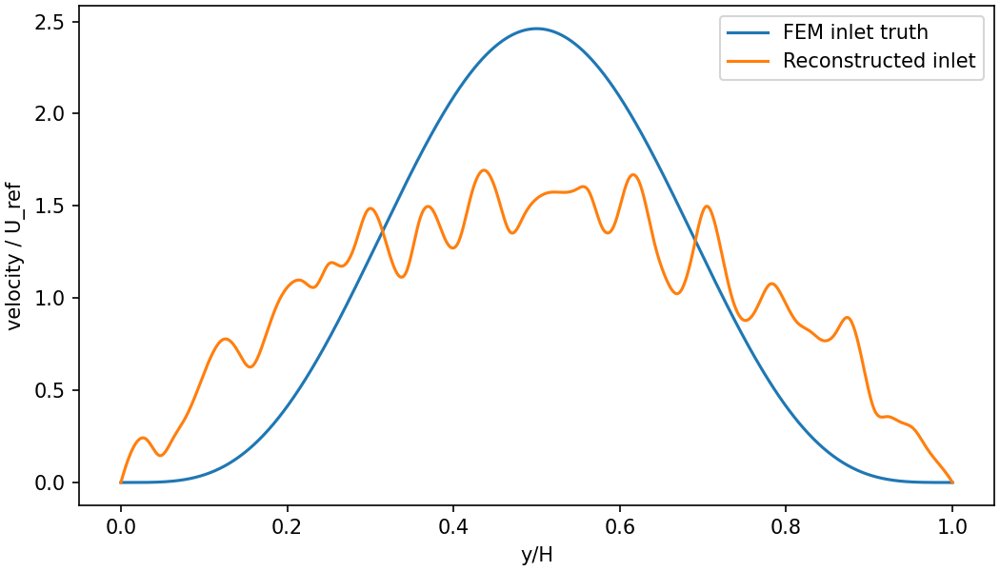
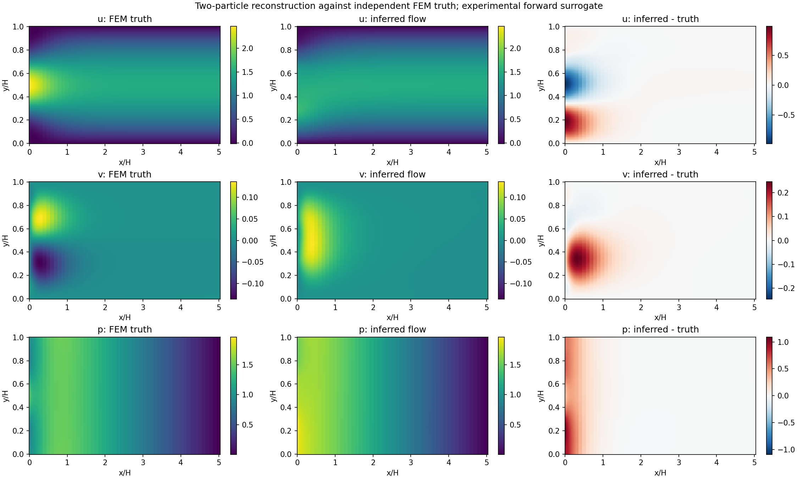
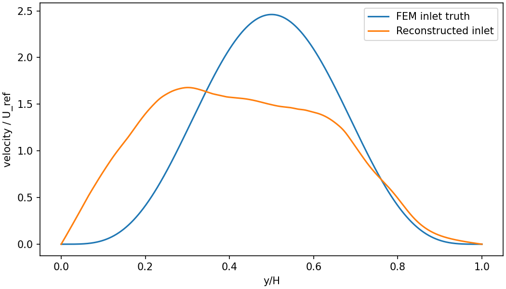

# نتیجهٔ واقعی بازسازی از دو مسیر

همهٔ مثال‌ها از میدان مستقل FEMِ Beta ساخته شده‌اند. میدان و پروفایل واقعی به objective مسئلهٔ معکوس داده نشده‌اند. داده‌ها مصنوعی و برای توسعه‌اند؛ این‌ها تضمین دقت روی آزمایش واقعی یا همهٔ ورودی‌ها نیستند.

| مثال | بیشینهٔ RMSE موقعیت / H | خطای کل میدان سرعت ٪ | خطای ورودی ٪ | خطای فشار ٪ | RMS مومنتوم |
|---|---:|---:|---:|---:|---:|
| [پرتاب مایل، تطبیق مسیر](examples/development/trajectory_only_initial/result/report.json) | 0.000513 | 21.51 | 41.38 | 34.54 | 16.6865 |
| [پرتاب مایل، فیزیک و همواری](examples/fem_beta/result/report.json) | 0.001898 | 21.22 | 40.21 | 42.80 | 4.6609 |
| [پرتاب گوشه‌ای، بدون پیش‌شرط‌سازی](examples/corner_launch/result/report.json) | 0.002201 | 24.01 | 40.17 | 49.87 | 5.5414 |
| [پرتاب گوشه‌ای، پیش‌شرط‌سازی با تمام گره‌ها](examples/corner_launch_preconditioned/result/report.json) | 0.000668 | 26.91 | 43.15 | 33.00 | 0.5312 |

جدول، نتیجهٔ بهترین شروع را مطابق objective همان اجرا نشان می‌دهد. ورودی‌های پرتابِ مثال مایل و گوشه‌ای متفاوت‌اند؛ اختلاف ردیف‌ها آزمایش کنترل‌شدهٔ تک‌عامل نیست. کاهش خطای مسیر به معنی کاهش خطای کل میدان نیست.

در نمونهٔ نخست، تطبیق مسیر بسیار خوب بود ولی خطای کل سرعت بیش از ۲۰٪ ماند. به همین دلیل فیزیک و prior در حل‌کنندهٔ فعلی لحاظ شده‌اند. این اصلاح، تضمین صحت جریان یا رفع خطای اپراتور مبنا نیست.

پیش‌شرط‌سازی یک تبدیل مثبت‌معین و وارون‌پذیر روی تمام پارامترهای گره‌ای است؛ هیچ مود یا گره‌ای حذف نشده است. سپس tanh حدود log-amplitude را اعمال می‌کند. همواری روی خود spline و NS در objective سنجیده می‌شوند. رتبهٔ Jacobian فقط داده، به آستانه و مختصات پارامترها وابسته است.

نتایج ناموفق و شروع‌های ناتمام حذف نشده‌اند. وضعیت `optimizer_success` هر شروع و پیام رسیدن به سقف iteration در JSON محفوظ است. `trajectory_consistency_passed` فقط کنترل مسیر است و پذیرش فیزیک یا بازسازی کل میدان محسوب نمی‌شود.

مدل جریان مبنا همچنان وضعیت پذیرش منفی دارد. دو مرجع رزروشدهٔ اصلی پروژه در این کار استفاده نشده‌اند. پراکندگی چند شروع، عدم‌قطعیت کالیبره‌شده نیست.

## پرتاب مایل، تطبیق مسیر

میانگین سرعت تخمینی 1.000973، مقدار واقعی ۱؛ رتبهٔ محلی داده 24 از 63 پارامتر آزاد. زمان اجرا با compile حدود 60.4 ثانیه؛ همگرایی تمام شروع‌ها: False.

[دو مسیر و تخمین ورودی](examples/development/trajectory_only_initial/result/trajectories_and_inlet.png) · [مقایسهٔ عددی با حقیقت FEM](examples/development/trajectory_only_initial/result/truth_comparison.json) · [ورودی قابل اجرا](examples/development/trajectory_only_initial/problem.json)

## پرتاب مایل، فیزیک و همواری

میانگین سرعت تخمینی 1.010470، مقدار واقعی ۱؛ رتبهٔ محلی داده 24 از 63 پارامتر آزاد. زمان اجرا با compile حدود 205.4 ثانیه؛ همگرایی تمام شروع‌ها: False.

[دو مسیر و تخمین ورودی](examples/fem_beta/result/trajectories_and_inlet.png) · [مقایسهٔ عددی با حقیقت FEM](examples/fem_beta/result/truth_comparison.json) · [ورودی قابل اجرا](examples/fem_beta/problem.json)

## پرتاب گوشه‌ای، بدون پیش‌شرط‌سازی

میانگین سرعت تخمینی 1.004052، مقدار واقعی ۱؛ رتبهٔ محلی داده 26 از 63 پارامتر آزاد. زمان اجرا با compile حدود 390.2 ثانیه؛ همگرایی تمام شروع‌ها: False.

[دو مسیر و تخمین ورودی](examples/corner_launch/result/trajectories_and_inlet.png) · [مقایسهٔ عددی با حقیقت FEM](examples/corner_launch/result/truth_comparison.json) · [ورودی قابل اجرا](examples/corner_launch/problem.json)

## پرتاب گوشه‌ای، پیش‌شرط‌سازی با تمام گره‌ها

میانگین سرعت تخمینی 1.002360، مقدار واقعی ۱؛ رتبهٔ محلی داده 11 از 63 پارامتر آزاد. زمان اجرا با compile حدود 412.6 ثانیه؛ همگرایی تمام شروع‌ها: False.

[دو مسیر و تخمین ورودی](examples/corner_launch_preconditioned/result/trajectories_and_inlet.png) · [مقایسهٔ عددی با حقیقت FEM](examples/corner_launch_preconditioned/result/truth_comparison.json) · [ورودی قابل اجرا](examples/corner_launch_preconditioned/problem.json)
