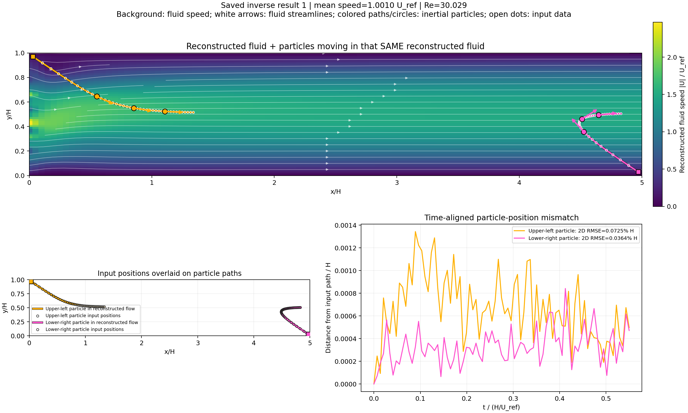
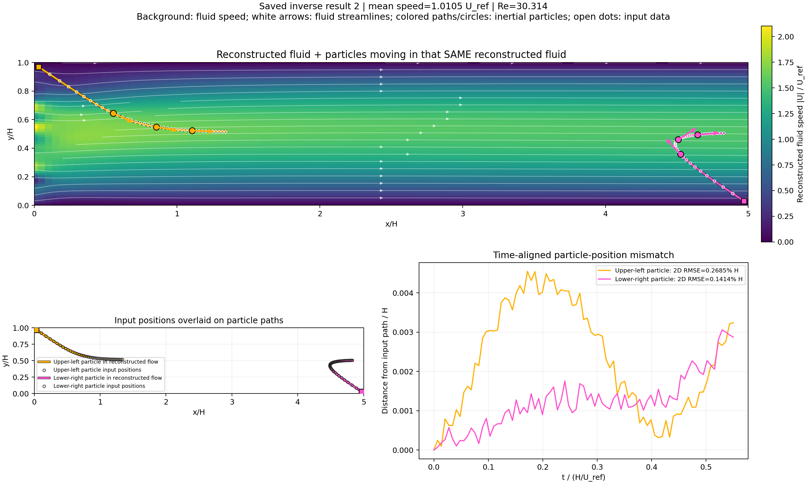
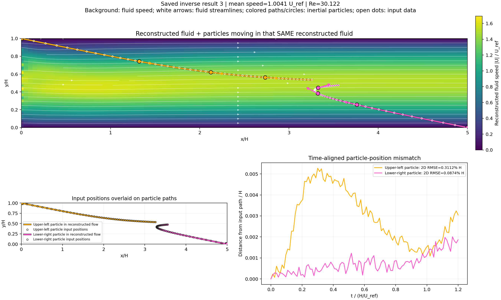
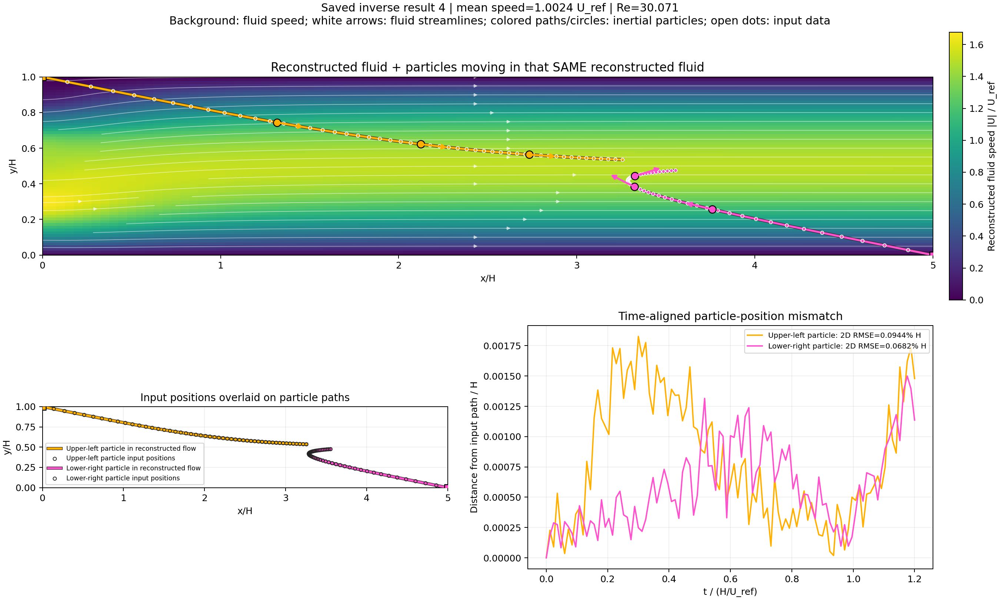

# سیال بازسازی‌شده و ذرات در همان سیال

پس‌زمینه، اندازهٔ سرعت **همان سیال تخمینی ذخیره‌شده** است. پیکان‌های سفید جهت جریان سیال را نشان می‌دهند. خط‌ها، دایره‌ها و پیکان‌های رنگی، مسیر و جهت حرکت ذرات اینرسی‌دار در آن سیال‌اند؛ نقطه‌های توخالی، مسیر ورودی هستند.

ذره به دلیل اینرسی الزاماً روی خط جریان حرکت نمی‌کند؛ برگشت جهت ذرهٔ پرتاب‌شده از راست در تصویر دیده می‌شود. دایره‌های رنگی، مکان ذرات در یک‌چهارم، نصف و سه‌چهارم بازهٔ مشاهده هستند. طول پیکان ذرات فقط برای نمایش جهت است.

در هر شکل، پایینِ تصویر مسیرهای ورودی/خروجی روی هم قرار گرفته‌اند و فاصلهٔ آن‌ها در زمان یکسان نمایش داده شده است. همهٔ داده‌ها از جواب‌های قبلی خوانده شده‌اند؛ مدل، پروفایل، میدان و مسیرهای قبلی تغییر نکرده‌اند.

## جواب ذخیره‌شدهٔ 1

[PDF](case_1/flow_and_particles.pdf) · [منشأ و هش داده‌های تصویر](case_1/flow_and_particles.json)

## جواب ذخیره‌شدهٔ 2

[PDF](case_2/flow_and_particles.pdf) · [منشأ و هش داده‌های تصویر](case_2/flow_and_particles.json)

## جواب ذخیره‌شدهٔ 3

[PDF](case_3/flow_and_particles.pdf) · [منشأ و هش داده‌های تصویر](case_3/flow_and_particles.json)

## جواب ذخیره‌شدهٔ 4

[PDF](case_4/flow_and_particles.pdf) · [منشأ و هش داده‌های تصویر](case_4/flow_and_particles.json)

[جدول و نمودارهای تفصیلی مقایسهٔ مسیر](README.md)

بازتولید: `python -m scripts.plot_reconstructed_fluid_and_particles`
