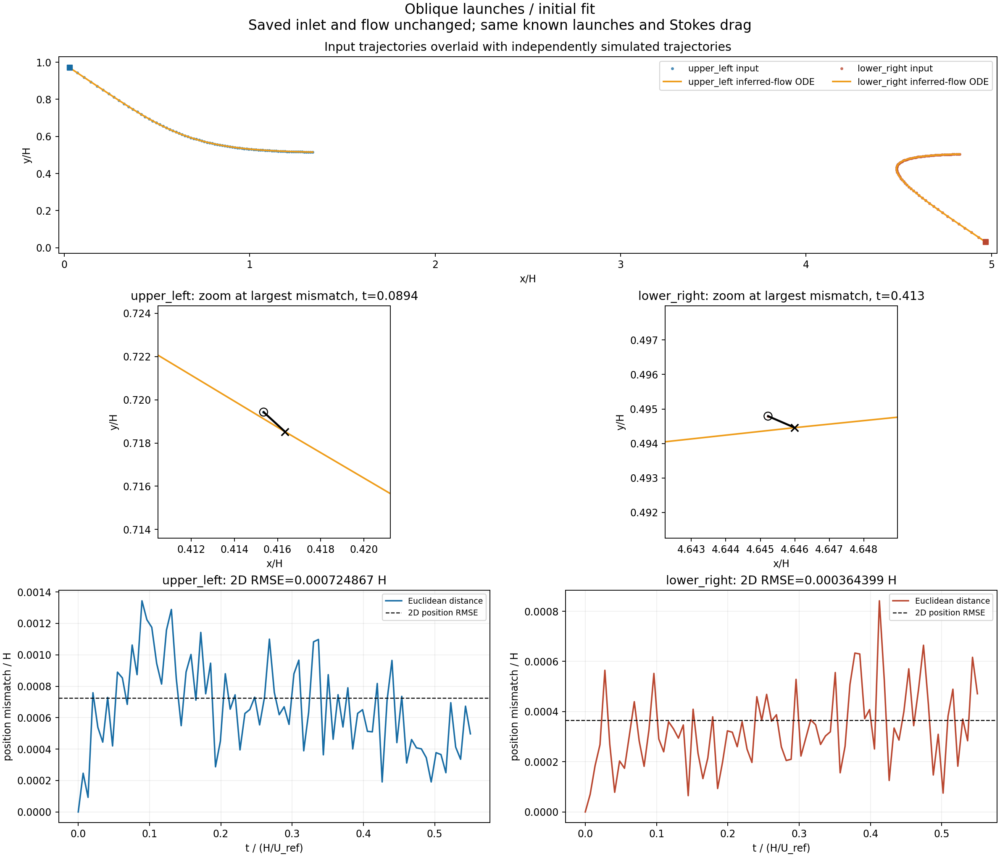
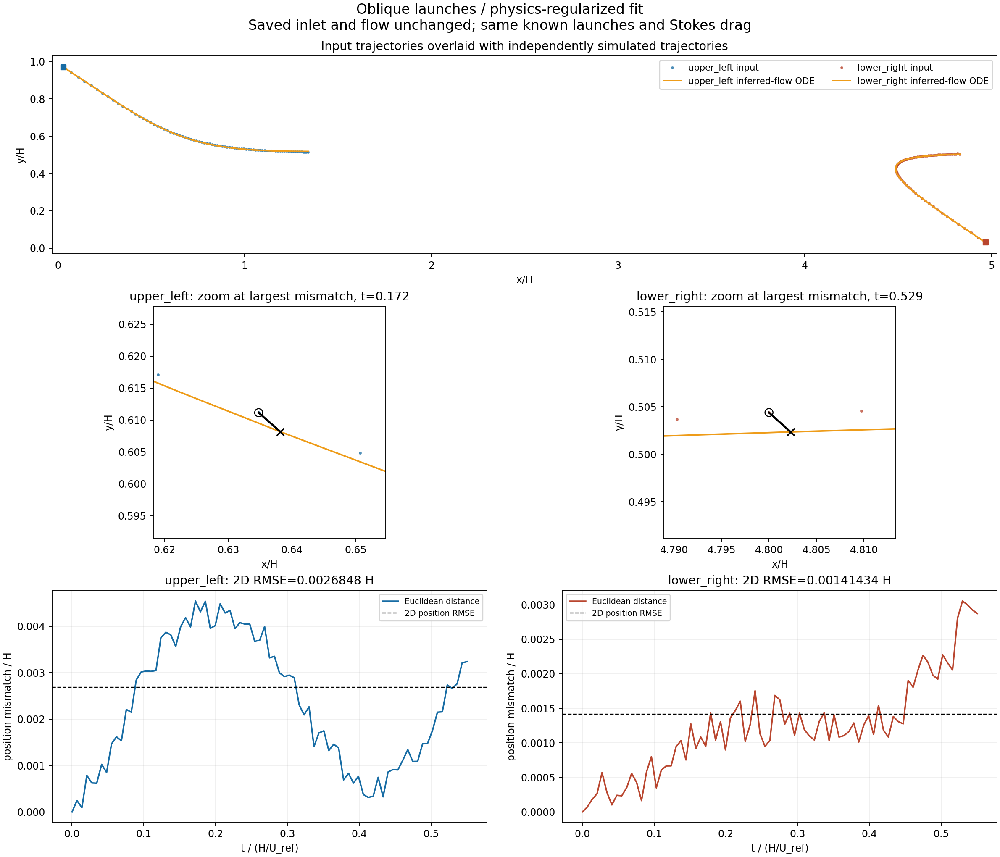
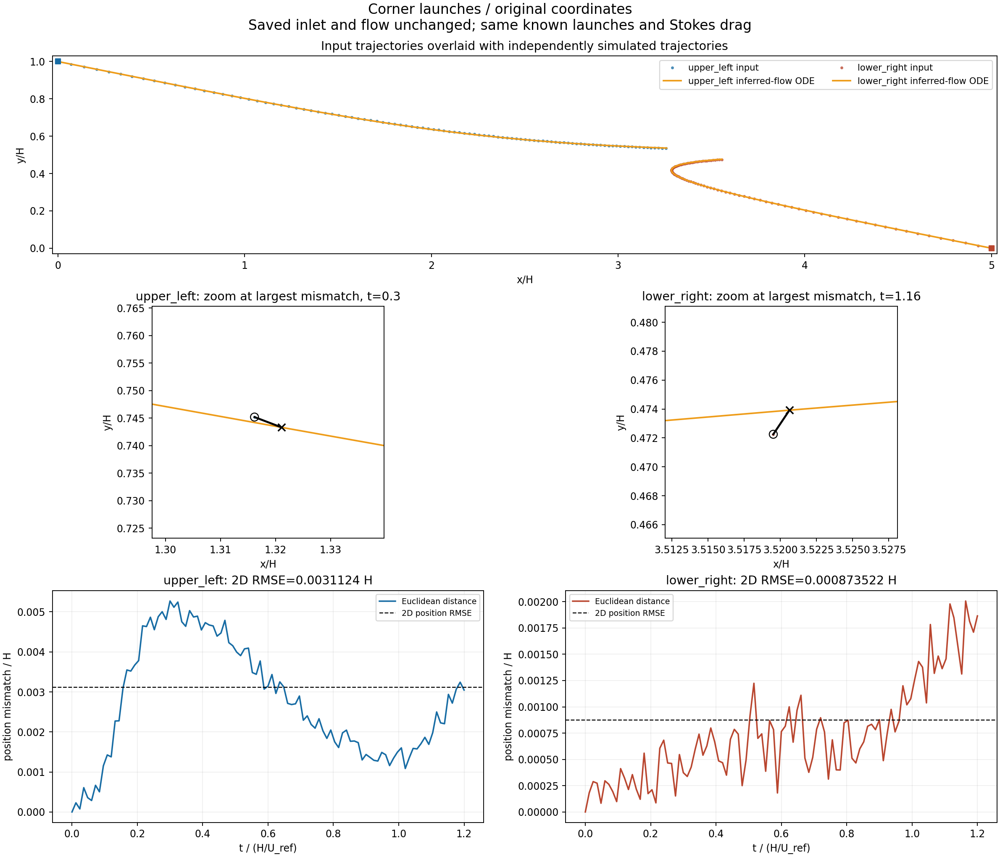
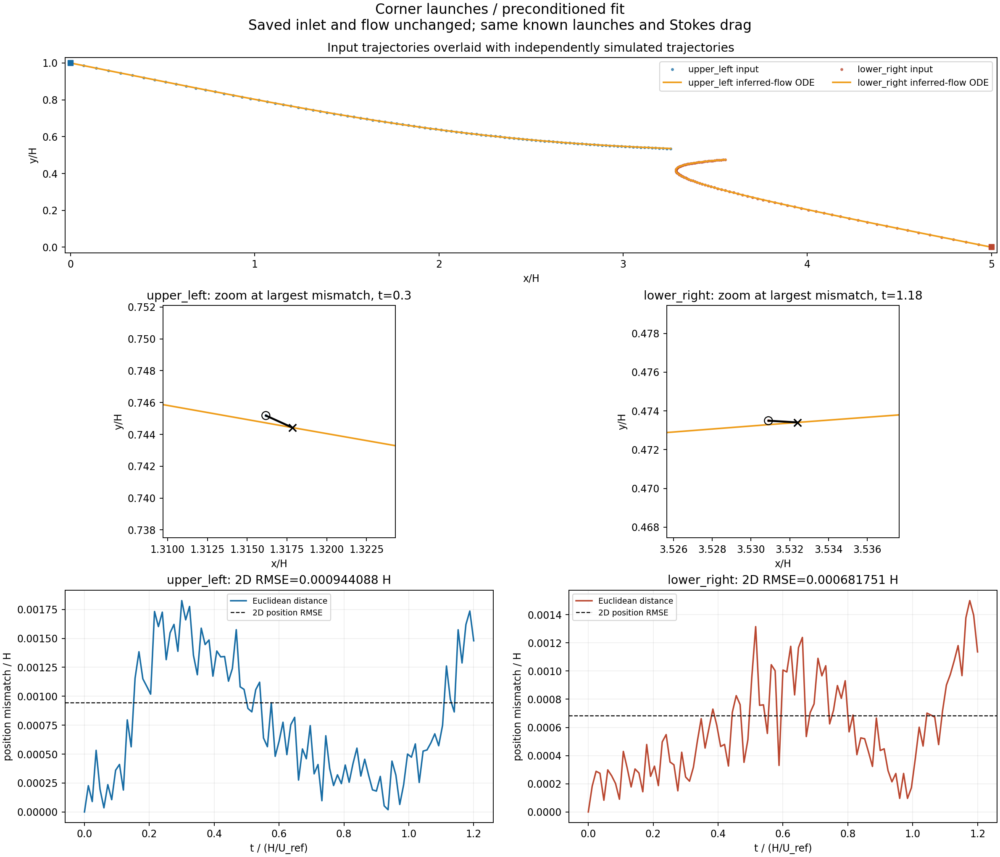

# تطبیق مسیر ورودی با حرکت در جریان تخمین‌زده‌شده

در این بخش فقط می‌سنجیم آیا جریانِ تخمین‌زده‌شده، ذره را تقریباً در همان مسیر داده‌شده حرکت می‌دهد. هیچ مقایسهٔ میدان یا ورودی با مرجع عددی در این بخش انجام نشده است.

جواب‌های ذخیره‌شده بدون بهینه‌سازی دوباره بارگذاری شده‌اند. برای هر ذره، معادلهٔ حرکت با همان مکان و سرعت اولیه و همان زمان پاسخ استوکس، مستقل دوباره حل شده است. سرعت سیال در مکانِ پیش‌بینی‌شدهٔ خود ذره ارزیابی می‌شود؛ مسیر مشاهده‌شده به حل ODE تحمیل نمی‌شود.

**چهار جواب قبلی، شامل هشت مسیر ذره، مقایسه شده‌اند.** این‌ها چهار جواب برای دو مجموعهٔ ورودی‌اند؛ هشت آزمایش مستقل نیستند. مسیر ورودی شامل همان نویز موجود در دادهٔ ذخیره‌شده است.

| جواب ذخیره‌شده | ذره | RMSE دوبعدی / H | RMSE دوبعدی، درصد H | بیشینهٔ فاصله / H | تمام زمان‌ها پوشش داده شد؟ |
|---|---|---:|---:|---:|---|
| [پرتاب مایل، جواب اولیه](case_1/overlay_and_error.png) | upper_left | 0.0007249 | 0.0725٪ | 0.0013435 | بله |
| [پرتاب مایل، جواب اولیه](case_1/overlay_and_error.png) | lower_right | 0.0003644 | 0.0364٪ | 0.0008417 | بله |
| [پرتاب مایل، جواب با قید فیزیک](case_2/overlay_and_error.png) | upper_left | 0.0026848 | 0.2685٪ | 0.0045452 | بله |
| [پرتاب مایل، جواب با قید فیزیک](case_2/overlay_and_error.png) | lower_right | 0.0014143 | 0.1414٪ | 0.0030541 | بله |
| [پرتاب گوشه‌ای، جواب قبلی](case_3/overlay_and_error.png) | upper_left | 0.0031124 | 0.3112٪ | 0.0052709 | بله |
| [پرتاب گوشه‌ای، جواب قبلی](case_3/overlay_and_error.png) | lower_right | 0.0008735 | 0.0874٪ | 0.0020062 | بله |
| [پرتاب گوشه‌ای، جواب پیش‌شرط‌سازی‌شده](case_4/overlay_and_error.png) | upper_left | 0.0009441 | 0.0944٪ | 0.0018263 | بله |
| [پرتاب گوشه‌ای، جواب پیش‌شرط‌سازی‌شده](case_4/overlay_and_error.png) | lower_right | 0.0006818 | 0.0682٪ | 0.0014998 | بله |

RMSE دوبعدی برابر `sqrt(mean(dx²+dy²))` است. در گزارش‌های قبلی RMSE مختصاتی `sqrt(mean([dx²,dy²]))` آمده بود؛ RMSE دوبعدی این جدول √۲ برابر آن است. هر دو تعریف در CSV ذخیره شده‌اند. درصدها نسبت به ارتفاع کانال H هستند، نه درصد فاصلهٔ طی‌شده.

خطوط نارنجی مسیر خروجی و نقطه‌ها مسیر ورودی‌اند. بزرگ‌نمایی در زمان بیشینهٔ اختلاف، خطای کوچک را قابل دیدن می‌کند. نمودار فاصله و نمودار x(t)،y(t) مقایسه در زمان یکسان را نشان می‌دهند.

این نتیجه میزان سازگاری همین جریانِ تخمینی با همین مسیرهای داده‌شده را نشان می‌دهد؛ تأیید یکتایی جریان یا دقت آن در همهٔ نقاط کانال نیست. مسیرها برای استنتاج استفاده شده‌اند و این مقایسه آزمون مسیرِ دیده‌نشده محسوب نمی‌شود.

## پرتاب مایل، جواب اولیه



[مقایسهٔ x(t) و y(t)](case_1/position_time_series.png) · [پروفایل تخمینی استفاده‌شده](case_1/inlet_used.png) · [PDF](case_1/overlay_and_error.pdf) · [اعداد کامل](case_1/metrics.json)

## پرتاب مایل، جواب با قید فیزیک



[مقایسهٔ x(t) و y(t)](case_2/position_time_series.png) · [پروفایل تخمینی استفاده‌شده](case_2/inlet_used.png) · [PDF](case_2/overlay_and_error.pdf) · [اعداد کامل](case_2/metrics.json)

## پرتاب گوشه‌ای، جواب قبلی



[مقایسهٔ x(t) و y(t)](case_3/position_time_series.png) · [پروفایل تخمینی استفاده‌شده](case_3/inlet_used.png) · [PDF](case_3/overlay_and_error.pdf) · [اعداد کامل](case_3/metrics.json)

## پرتاب گوشه‌ای، جواب پیش‌شرط‌سازی‌شده



[مقایسهٔ x(t) و y(t)](case_4/position_time_series.png) · [پروفایل تخمینی استفاده‌شده](case_4/inlet_used.png) · [PDF](case_4/overlay_and_error.pdf) · [اعداد کامل](case_4/metrics.json)

بازتولید از ریشهٔ مخزن:

```bash
python -m scripts.compare_reconstructed_trajectories
```

[شاهد تغییرنکردن فایل‌های قبلی](preservation_check.json) · [CSV تمام مقایسه‌ها](summary.csv)
