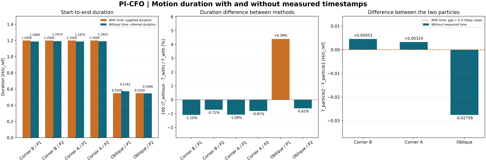

# مقایسهٔ مدت حرکت دو روش

این بررسی فقط از نتایج ذخیره‌شده خوانده شده است؛ هیچ برازش مجدد یا تغییری در نتایج قبلی انجام نشده است.

**زمان‌ها بی‌بعد و برحسب H/U_ref هستند، نه ثانیه.** برای زمان فیزیکی باید مقدار جدول در H/U_ref فیزیکی ضرب شود.

در روش زمان‌دار، مدت از داده معلوم بوده و مستقلاً پیش‌بینی نشده است. در روش بدون زمان، مدت از ساعت پنهان به دست آمده است. منظور از رسیدن، پایان مسیر برازش‌شده است؛ ذره در حل مستقل الزاماً دقیقاً از نقطهٔ انتهایی مشاهده‌شده عبور نمی‌کند. این اعداد زمان اولین برخورد دقیق با مقصد نیستند. اختلاف مکانی انتها نیز در جدول آمده است.

[PDF برداری](duration_comparison.pdf) · [CSV اعداد](durations.csv)

| مثال | ذره | مدت روش با زمان | مدت روش بدون زمان | اختلاف علامت‌دار | اختلاف نسبی | اختلاف مکانی انتها، درصد H |
|---|---:|---:|---:|---:|---:|---:|
| گوشه‌ای B | 1 | 1.200000 | 1.186832 | -0.013168 | -1.097٪ | 0.0082 |
| گوشه‌ای B | 2 | 1.200000 | 1.191365 | -0.008635 | -0.720٪ | 0.0648 |
| گوشه‌ای A | 1 | 1.200000 | 1.187020 | -0.012980 | -1.082٪ | 0.0461 |
| گوشه‌ای A | 2 | 1.200000 | 1.190264 | -0.009736 | -0.811٪ | 0.0633 |
| پرتاب مایل | 1 | 0.550000 | 0.574160 | +0.024160 | +4.393٪ | 0.2197 |
| پرتاب مایل | 2 | 0.550000 | 0.546584 | -0.003416 | -0.621٪ | 0.0738 |

اختلاف منفی یعنی مدت تخمینی روش بدون زمان کوتاه‌تر بوده است.

## اختلاف مدت میان دو ذره

در این مثال‌ها زمان شروع هر دو ذره صفر است. هر ذره به انتهای مسیر خودش می‌رود؛ مقصد مشترک یا برخورد دو ذره مدنظر نیست. اختلاف زیر برابر مدت ذرهٔ دوم منهای ذرهٔ اول است.

| مثال | روش با زمان | روش بدون زمان |
|---|---:|---:|
| گوشه‌ای B | +0.000000 | +0.004533 |
| گوشه‌ای A | +0.000000 | +0.003245 |
| پرتاب مایل | +0.000000 | -0.027575 |

در روش زمان‌دار، صفر بودن اختلاف دو ذره از پنجرهٔ مشاهدهٔ یکسان می‌آید و به معنی رسیدن واقعی هم‌زمان به مقصد مشترک نیست.

بازتولید از ریشهٔ مخزن: `python flow_reconstruction_no_time/arrival_time_comparison/build.py`
