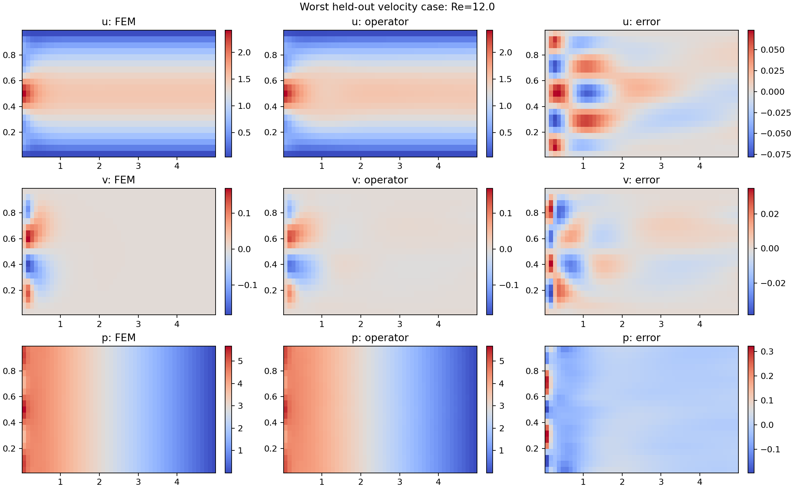

# نتیجهٔ آزمایش: اپراتور شرطی جریان کانال

**نتیجهٔ کلی: نسخهٔ پژوهشی ساخته و آموزش داده شد، اما حل عمومی قابل‌اعتماد هنوز تأیید نشده است.** وزن قابل اجرا در `models/channel_operator_candidate.pt` قرار دارد و به آموزش مجدد برای هر ورودی نیاز ندارد. این وزن منتخب روی CPU آموزش و پالایش شد؛ دو اجرای مستقل روی GPU Tesla T4 در حساب Kaggle نیز کامل شدند.

## مسئله و روش

کانال ۵×۱، ناویر–استوکس دوبعدی پایا و بی‌بعد، رینولدز ۱۰ تا ۱۰۰، ورودی branch شامل ۳۳ نمونهٔ پروفایل و log(Re)، خروجی u,v,p است. ورودی و عدم لغزش دیواره به‌صورت سخت اعمال می‌شوند و خروجی از شرط طبیعی do-nothing با فشار خارجی مرجع صفر استفاده می‌کند. چهار مود کسینوسی با شعاع L1 حداکثر ۰٫۶ خانوادهٔ آموزش را تعریف می‌کنند. روش **هیبریدی FEM + Physics-informed DeepONet** است، نه آموزش بدون دادهٔ حل.

آموزش وزن منتخب شامل ۴۰۰۰ گام روی ۲۴ شرط، ۶۰۰۰ گام دیگر روی ۱۲۸ شرط، و ۶۰۰۰ گام آخر روی ۱۹۲ شرط است؛ وزن جملهٔ داده به‌ترتیب ۲۰۰، ۱۰۰۰ و ۴۰۰۰ بود. تعداد ۱۹۲ مربوط به مجموعهٔ آخر است؛ مجموعهٔ اولیهٔ ۲۴حالته نیز قبلاً دیده شده است. پس از شروع آزمون نهایی، وزن‌ها تغییر نکردند.

## هشت ورودی تازه

Seed آزمون نهایی ۶۴۰۵۲۹ است و با چهار ورودی توسعه متفاوت است. هر مرجع با FEM غیرخطی مستقل Taylor–Hood P2/P1 حل و با دو شبکه مقایسه شد. اعداد جدول، بدترین حالت در هشت آزمون هستند.

| کمیت | نتیجه | حد هدف | وضعیت |
|---|---:|---:|---|
| سرعت، L2 نسبی | 1.903٪ | ۵٪ | قبول |
| فشار، L2 نسبی | 1.711٪ | ۱۰٪ | قبول |
| خطای دبی | 0.474٪ | ۲٪ | قبول |
| RMS واگرایی | 0.02878 | ۰٫۰۳ | قبول |
| RMS مومنتوم | 0.56648 | ۰٫۰۵ | رد |
| RMS شرط خروجی مقیاس‌شده | 0.20207 | ۰٫۱ | رد |

میانگین خطای سرعت 0.726٪ و فشار 0.643٪ بود. مقدار کلی `passed` در گزارش **false** است؛ دقت خوب میدان‌ها به‌معنی همگرایی کافی باقی‌ماندهٔ معادلات نیست.



## شانزده حالت مرزی سخت‌تر

برای هر یک از چهار مود، ضریب خالص ±۰٫۶ و رینولدزهای ۱۰ و ۱۰۰ بدون تغییر وزن‌ها آزمایش شدند. این شرط‌های دقیق در آموزش استفاده نشده بودند.

- بیشینهٔ خطای سرعت: **5.78٪**.
- بیشینهٔ خطای فشار: **57.67٪**.
- معیار سرعت/فشار این آزمون نیز رد شد.

بدترین خطای فشار مربوط به مود چهارم با ضریب +۰٫۶ و Re=100 است. ریزترکردن مرجع از ۶۴×۲۴ به ۹۶×۳۶، فشار مرجع را فقط حدود ۰٫۲۹٪ تغییر داد؛ بنابراین خطای حدود ۵۸٪ را نمی‌توان با خطای شبکهٔ مرجع توضیح داد. باقی‌ماندهٔ مومنتوم در مورد سخت آزمون هشت‌حالته با float32 و float64 تقریباً یکسان بود و با حذف فقط ناحیهٔ بسیار نزدیک ورودی هم برطرف نشد. محدودیت مربوط به مدل آموزش‌دیده است.

چهار حالت توسعه در انتهای آموزش همهٔ معیارها را پاس کردند (خطای بیشینهٔ سرعت حدود ۰٫۸۴٪ و فشار ۰٫۸۹٪)؛ این نتیجه با عملکرد روی مجموعه‌های تازه یکسان نیست و به‌عنوان تأیید عمومی استفاده نمی‌شود.

## اجراهای GPU

این دو اجرا از مجموعهٔ آزمون اولیهٔ هشت‌حالته با seed مربوط به pipeline اصلی استفاده کردند؛ آن مجموعه با آزمون تازهٔ جدول بالا یکسان نیست.

| اجرا | گام | بیشینه خطای سرعت | بیشینه خطای فشار | نتیجهٔ کامل |
|---|---:|---:|---:|---|
| [پایه](https://www.kaggle.com/code/mohrezsayeh/channel-pi-deeponet-re10-100) | 12000 | 2.73٪ | 6.02٪ | رد: مومنتوم |
| [ویژگی ورودی](https://www.kaggle.com/code/mohrezsayeh/channel-pi-deeponet-entrance) | 6000 | 2.77٪ | 6.20٪ | رد: مومنتوم |

نوت‌بوک‌ها خصوصی هستند. لاگ و گزارش عددی از API دریافت شد. بارگیری checkpointهای GPU با خطای 403 پراکسی روی `www.kaggleusercontent.com` مسدود شد؛ این دامنه به پیش‌نویس شبکه افزوده شده، اما ذخیرهٔ پیش‌نویس آن را فعال یا محیط را Publish نمی‌کند. برای دریافت آن فایل‌ها باید تغییر را در تنظیمات مرور/ذخیره و سپس محیط را Publish کرد. checkpoint کوچک موجود در GitHub همان مدل منتخب محلی است، نه وزن یکی از دو اجرای GPU.

## استفاده و حدود اعتبار

```bash
python -m channel_operator.predict --checkpoint models/channel_operator_candidate.pt \
  --re 55 --inlet-csv examples/inlet_example.csv --output prediction.npz
```

برنامه فایل‌های میدان و تشخیص‌های فیزیکی را می‌نویسد و به‌دلیل معیارهای پاس‌نشده هشدار می‌دهد. شکل‌های بیرون از خانوادهٔ آموزش، بازگشت جریان، رینولدز خارج از بازه و جریان آشفته اعتبارسنجی نشده‌اند. برای ادامهٔ تحقیق، پوشش پروفایل‌های شدید و سازگاری مشتق‌ها، باقی‌ماندهٔ مومنتوم و شرط خروجی باید بهبود یابند؛ گزارش حاضر نتیجهٔ ناموفق این بخش‌ها را پنهان نمی‌کند.

داده‌های خام عددی: [آزمون تازه](metrics.json)، [آزمون مرزی](stress_test.json)، [بررسی ریزسازی مرجع](stress_reference_check.json)، [تشخیص باقی‌مانده](residual_diagnosis.json)، [متادیتای وزن](../models/metadata.json).
