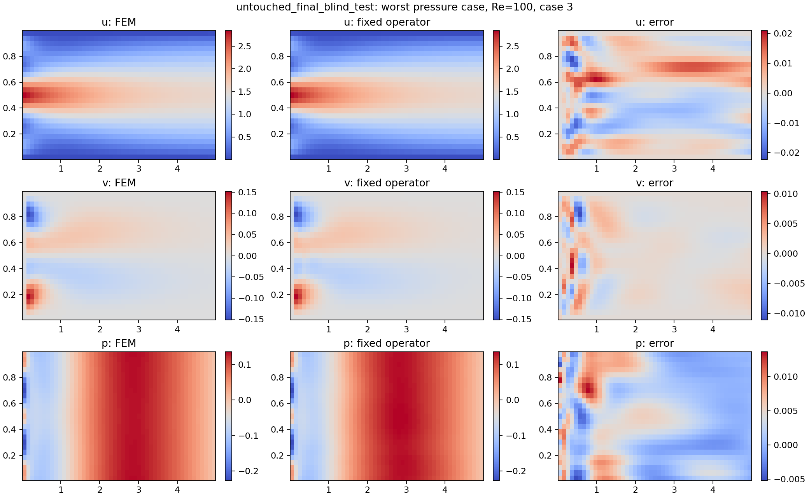
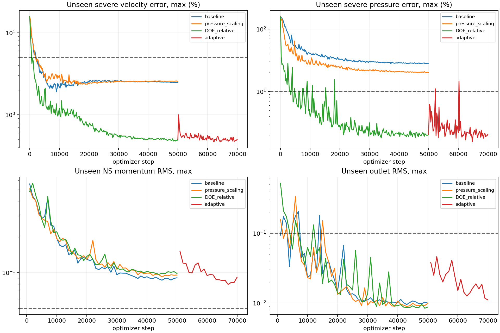

# نتیجهٔ نسخهٔ دوم و علت خطای نسخهٔ قبلی

نسخهٔ منتخب، یک **مدل هیبریدی FEM + Physics-informed DeepONet** با ۷۰هزار به‌روزرسانی عمومی است. برای پیش‌بینی ورودی تازه آموزش مجدد انجام نمی‌دهد. خطای بزرگ فشار در آزمون‌های شدید برطرف شده، ولی معیار سخت‌گیرانهٔ باقی‌ماندهٔ مومنتوم هنوز پاس نشده است؛ این مدل را حل عمومیِ بدون محدودیت معرفی نمی‌کنیم.

## نتیجهٔ مدل ثابت

| مجموعه | تعداد | بیشینهٔ خطای بردار سرعت | بیشینهٔ خطای فشار | RMS مومنتوم، بیشینه |
|---|---:|---:|---:|---:|
| پایشِ خارج از آموزش | 16 | 0.500٪ | 2.065٪ | 0.0778 |
| آزمون نهایی مستقل و شدیدتر | 8 | 0.567٪ | 4.224٪ | 0.0853 |

معیارهای میدان، سرعت کمتر از ۵٪ و فشار کمتر از ۱۰٪ بودند؛ هر دو مجموعه این معیارها را پاس کردند. معیار مومنتوم ۰٫۰۵ بود و پاس نشد. بقای جرم، دبی، ورودی، دیواره‌ها و شرط خروجی پاس شدند. `all_gates_passed=false` عمداً در متادیتا و برنامهٔ پیش‌بینی حفظ شده است.

خطای سرعت جدول، L2 نسبی **بردار (u,v)** است. برای شفافیت، بیشینهٔ خطای نسبی مؤلفهٔ کوچک‌تر v در آزمون نهایی **7.57٪** و بیشینهٔ RMSE آن **0.00159 برابر سرعت میانگین ورودی** است. مقایسهٔ فشار بدون جابه‌جاکردن میانگین یا تنظیم پسینی gauge انجام شد.

وزن‌ها پیش از خواندن پیش‌بینی‌های آزمون نهایی ثابت و SHA256 آن‌ها در [سند انتخاب checkpoint](checkpoint_selection.json) ثبت شد. پس از آن آموزش دیگری انجام نشد.

وزن ثابتِ نسخهٔ قبلی، روی همین شانزده مرجع CFD جدید، بیشینهٔ خطای سرعت 5.78٪ و فشار 57.74٪ داشت. این مقایسه با مدل قبلیِ آموزش‌دیده است؛ مقادیر گام صفر در منحنی‌ها به مدل جدیدِ هنوز آموزش‌ندیده مربوط‌اند.

## مشکل دقیقاً کجا بود؟

شواهد از چند عامل حمایت می‌کنند؛ یک علت یگانه برای همهٔ خطاها ادعا نمی‌شود.

1. **پوشش ورودی‌های سخت ناقص بود.** در دادهٔ قبلی ۱۹۲حالته، بزرگ‌ترین قدر مطلق ضریب هر مود حدود ۰٫۲۸ تا ۰٫۴۲ بود، ولی آزمون ضریب ±۰٫۶ داشت. حتی در مجموعهٔ تصادفی جدید ۱۲۸حالته، برای چند محور شدید در Re بالا هیچ برچسب CFD وجود نداشت. مجموعهٔ نهایی ۲۸۸حالته، دامنهٔ L1 تا ۰٫۸ را پوشش می‌دهد و نقاط منظم در دامنه‌های ±۰٫۳، ±۰٫۵، ±۰٫۷، ±۰٫۸ و Reهای ۱۰، ۳۰، ۶۰، ۱۰۰ دارد. ±۰٫۶ عمداً از آموزش کنار گذاشته شده است.
2. **مقیاس loss با معیار مورد نظر یکسان نبود.** وزن داده ۴۰۰۰ و خروجی ۰٫۱ بود. در batch تشخیصی، گرادیان داده حدود ۱۶ برابر مومنتوم و ۶۶ برابر شرط خروجی بود. مؤلفهٔ کوچک v و فشارِ کم‌مقدارِ بعضی شرط‌ها نیز در MSE معمولی کم‌وزن می‌شدند. در نسخهٔ جدید، مقیاس هر مؤلفه از RMS دادهٔ همان شرطِ آموزشی محاسبه می‌شود و سهم گرادیان داده/فیزیک کنترل می‌شود؛ هیچ RMS یا پاسخی از مجموعهٔ پایش برای این کار استفاده نمی‌شود.
3. **پارامتردهی تصحیح فشار شرطی‌سازی ضعیفی داشت.** تصحیح فشار همراه 1/Re مقیاس می‌شد، درحالی‌که فشار جابه‌جاییِ ورودی شدید می‌تواند O(1) باشد. حذف این ضریب از شاخهٔ تصحیح، فشار بی‌بعد یا معادلات را عوض نمی‌کند، اما اندازهٔ گرادیان‌ها و تابعی را که شبکه باید یاد بگیرد تغییر می‌دهد. آزمایش کنترل‌شده اثر آن را نشان داد.
4. **میدان و مشتق‌های آن دقت یکسان ندارند.** مطابق مثال بخش ۲ و شکل ۲ مقاله، کم‌بودن خطای پاسخ کافی نیست. نسخهٔ جدید u=psi_y و v=-psi_x دارد؛ ورودی، دیواره و بقای جرم در ساختار اعمال می‌شوند و باقی‌ماندهٔ مستقیم NS نیز آموزش داده می‌شود. modified MLP از کد رسمی و پیوست G اقتباس مفهومی شده است. پایش مشتق‌ها و خطای CFD در حین آموزش، جای لاگِ صرفاً loss را گرفته است.
5. **اجرای قدیمی با بودجهٔ زمانی سازگار نبود و resume کامل نبود.** مشتق‌های مرتبهٔ سوم در PyTorch حدود ۰٫۳ ثانیه در هر گام زمان می‌گرفتند. پیاده‌سازی JAX همان میدان، مشتق‌های سوم و گرادیان پارامترها را در آزمون‌های تطبیق بازتولید کرد و امکان اجرای کافی را داد. در resume قدیمی، seed دوباره از ابتدا تنظیم می‌شد و جریان پروفایل‌های تصادفی تکرار می‌شد؛ در نسخهٔ جدید وضعیت RNG و optimizer ذخیره و بازیابی می‌شود.

## آزمایش‌هایی که فرضیه‌ها را جدا کردند

| آزمایش | نتیجه |
|---|---|
| مشتق خودکار نسخهٔ قبل در برابر تفاضل محدود مستقل | اختلاف باقی‌مانده حدود ۳٫۵×۱۰⁻⁸ در نقطهٔ بررسی‌شده؛ شاهدی برای خطای علامت/مشتق در آن بررسی پیدا نشد |
| فقط وزن داده ۴۰۰۰ به ۲۰، ۵۰۰ گام، همان معماری و داده | مومنتوم در نقاط تازهٔ شرط‌های آموزشی حدود ۱۷٪ بهتر شد؛ فشار حالت‌های شدید همچنان نزدیک ۶۰٪ ماند |
| ۵۰هزار گام با مدل جریان‌تابع و دادهٔ تصادفی ۱۲۸حالته | فشار بیشینه حدود ۲۸٫۳٪؛ تعداد گام بیشتر به‌تنهایی کافی نبود |
| فقط اصلاح مقیاس تصحیح فشار، همان seed/معماری/داده/۵۰هزار گام | فشار بیشینه حدود ۲۰٫۱٪ |
| اصلاح ترکیبیِ پوشش داده و نرمال‌سازی نسبی، ۵۰هزار گام | فشار بیشینه حدود ۲٫۰۵٪ |
| ادامهٔ فیزیکی تطبیقی تا ۷۰هزار | خطای میدان تقریباً ثابت ماند؛ مومنتومِ نقاط پایش فقط از حدود ۰٫۰۹۸ به ۰٫۰۹۱ بهتر شد |

اصلاح پوشش و نرمال‌سازی در آزمایش آخر با هم انجام شدند؛ سهم مستقل هر یک از این دو با این اجرا به‌تنهایی تعیین نمی‌شود.

تحلیل SVD نشان داد ۳۲ مؤلفهٔ خطی، با ضرایب oracle، امکان تقریب فشارِ حالات پایش تا حدود ۰٫۸٪ را دارند. این فقط آزمون ظرفیت فضای جداشدنی است: ضرایب oracle از پاسخ پایش برای محاسبهٔ حد تقریب استفاده می‌کنند، وارد هیچ predictor یا optimizer نشده‌اند و نتیجهٔ یادگیری مدل نیستند. این تحلیل، ظرفیت نمایش مشتق‌های trunk یا یافتن optimum را تضمین نمی‌کند.

## آیا واقعاً یاد می‌گیرد؟

در هر ۲۵۰ گام، خطای u، v، p و بردار سرعت در هر یک از شانزده شرطِ خارج از آموزش چاپ شده است. هر ۱۰۰۰ گام باقی‌ماندهٔ NS و خروجی روی آن شرط‌ها نیز چاپ شده است.

در راهنمای نمودار، baseline مدل جریان‌تابع با ۱۲۸ شرط تصادفی و تصحیح فشار لزج است، نه نسخهٔ V1؛ pressure_scaling فقط مقیاس فشار را تغییر می‌دهد، DOE_relative اصلاح پوشش/نرمال‌سازی و adaptive ادامهٔ نمونه‌برداری تطبیقی است.

- [جدول خلاصهٔ تمام چاپ‌ها](iteration_errors.csv): ۶۸۴ رکورد از اجراهای کنترل و مدل اصلاح‌شده.
- [خطای تک‌تک حالات در هر چاپ](per_case_errors.csv): ۱۰۹۴۴ رکورد.
- [لاگ‌های اصلی JSONL و تنظیمات هر اجرا](curves/).

جدول پیشرفتِ اجرای اصلاح‌شده، قبل از ادامهٔ تطبیقی:

| گام | بیشینهٔ خطای سرعت | بیشینهٔ خطای فشار |
|---:|---:|---:|
| 0 | 15.661٪ | 157.766٪ |
| 1000 | 4.919٪ | 25.321٪ |
| 5000 | 2.008٪ | 8.613٪ |
| 10000 | 1.200٪ | 3.954٪ |
| 25000 | 0.645٪ | 3.440٪ |
| 50000 | 0.499٪ | 2.046٪ |

## استقلال آزمون و مرجع عددی

شانزده حالت پایش برای انتخاب تنظیمات و توقف بررسی شدند و «آزمون کور نهایی» نامیده نمی‌شوند. پاسخ آن‌ها هرگز وارد loss نشده است. هشت حالت نهاییِ شدیدتر با seed ازپیش‌تعیین‌شدهٔ ۷۱۱۵۹۰۳، فقط پس از ثابت‌شدن وزن‌ها ارزیابی شدند؛ دادهٔ آن‌ها به نوت‌بوک‌های آموزش منتقل نشده بود.

علاوه بر جدابودن فایل‌ها و گراف محاسباتی loss، ۴۰۰هزار ورودیِ تازهٔ مرحلهٔ اصلی و ۱۶۰هزار ورودی مرحلهٔ تطبیقی بازپخش شدند. هیچ پروفایل پایش یا آزمون نهایی در ورودی‌های optimizer پیدا نشد. وضعیت RNG انتهای بازپخش با checkpoint واقعی نیز یکسان بود: [بازبینی مرحلهٔ اصلی](input_audit_main.json)، [ادامه](input_audit_refine.json). این بررسی پاسخ‌های CFD را بارگذاری نمی‌کند.

حل مرجع مستقل، Taylor–Hood P2/P1 با Picard است. برای پایش از دو شبکهٔ ۸۰×۳۲ و ۵۶×۲۴ و برای آزمون نهایی از ۹۶×۳۶ و ۶۴×۲۸ استفاده شد. خطای ریزسازی هر مرجع کنترل شده است. داده‌ها و متادیتا در `data/v2/` موجودند. فشار خروجی در هر دو روش شرط طبیعی استاندارد do-nothing با فشار خارجی مرجع صفر دارد؛ این با صفرکردن نقطه‌ای کل فشار خروجی یکسان نیست.

## محدودیت باقی‌مانده

فقط معیار سخت‌گیرانهٔ مومنتوم پاس نشده است؛ این موضوع در متادیتا و هشدار inference حفظ شده است. تحلیل مکانیِ یک حالت سخت نشان داد حدود نیمی از مجموع مربع باقی‌مانده در ده درصد نخست طول کانال قرار دارد، ولی نیم دیگر در پایین‌دست پخش است؛ نمی‌توان همهٔ مشکل را فقط به ورودی نسبت داد. [نقشه](residual_map.png) و [اعداد](residual_localization.json) ثبت شده‌اند.

بازهٔ اعتبار آزمایش‌شده: کانال مستقیم ۵×۱، جریان آرام، Re از ۱۰ تا ۱۰۰ و ورودی صافِ مثبت از خانوادهٔ چهارمودی با شعاع L1 حداکثر ۰٫۸. برای تابع ورودی کاملاً دلخواه، مودهای بالاتر، برگشت جریان، هندسهٔ دیگر یا Re بیرون از بازه ادعایی نشده است. فایل CSV بیرون از این خانواده با پیام روشن رد می‌شود تا شرط مرزی بی‌صدا عوض نشود.

## فایل‌های قابل استفاده

- وزن inference: `models/v2/stream_operator.pt`.
- checkpoint کامل Adam و RNG برای ادامهٔ آموزش: `models/v2/jax_checkpoint.npz`.
- داده‌های مستقل آموزش، پایش و آزمون: `data/v2/train.npz`, `monitor.npz`, `blind.npz`.
- [نتایج هر شانزده حالت پایش](monitor/metrics.json) و [هر هشت آزمون نهایی](blind/metrics.json).
- [صحت انتقال وزنِ آموزش‌دیده بین JAX و PyTorch](trained_export_parity.json).
- [آزمون حل دقیق پوازی با شبکهٔ آموزش‌دیده، بدون صفرکردن تصحیح](trained_poiseuille_checks.json).

مقالهٔ ارائه‌شده: Wang, Wang & Perdikaris، arXiv:2103.10974v1؛ بخش‌های ۲ و ۳، مثال Burgers و پیوست G. آن مقاله این کانال ناویر–استوکس را مستقیماً حل نکرده است؛ روش و ساختار آن با این مسئله سازگار شده‌اند.
