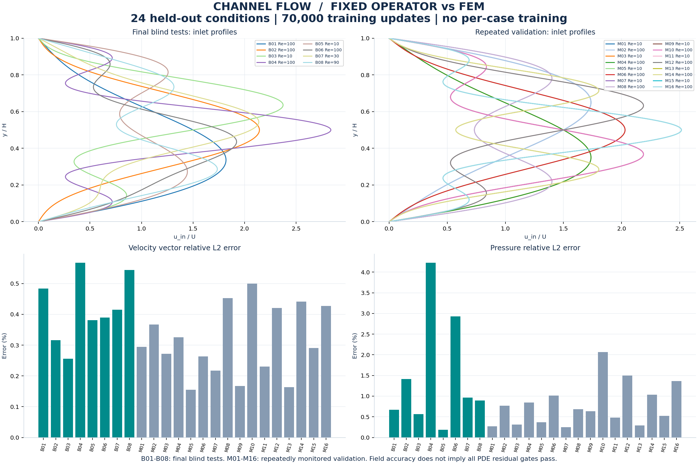
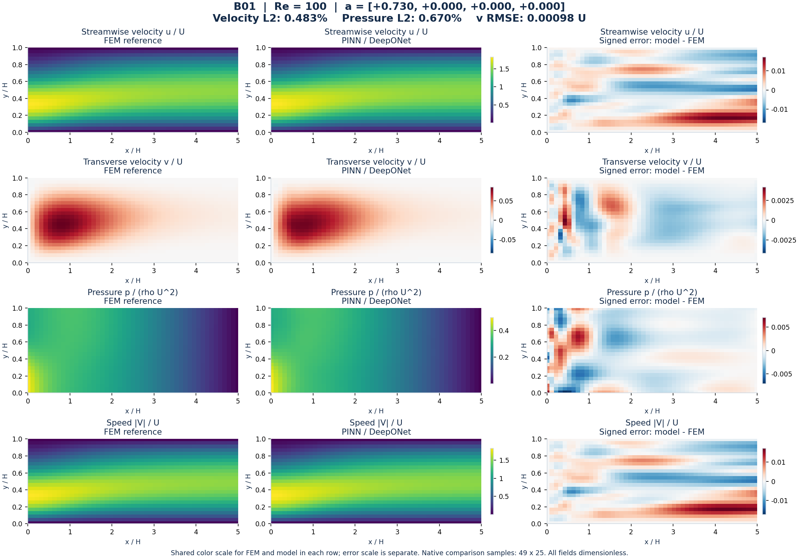
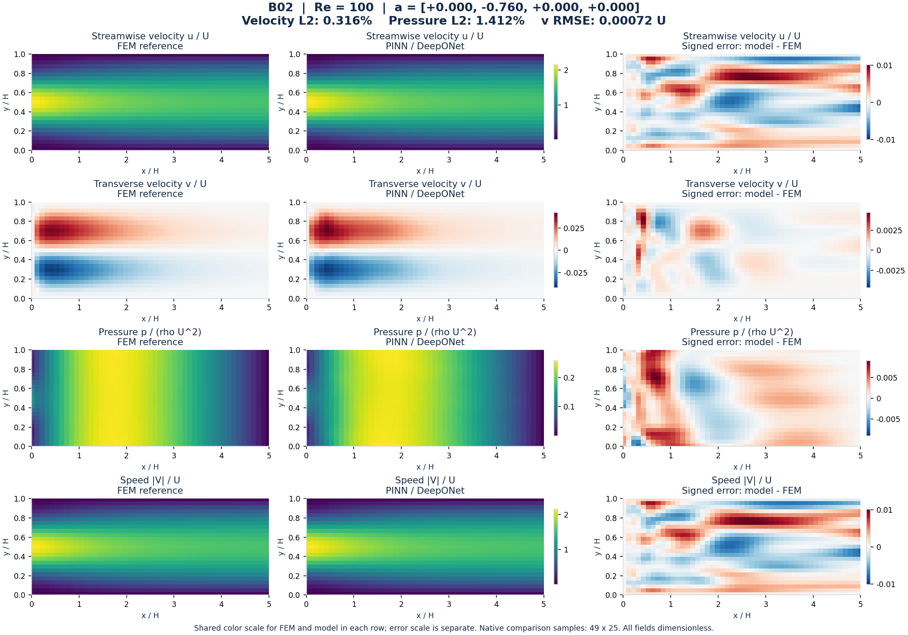
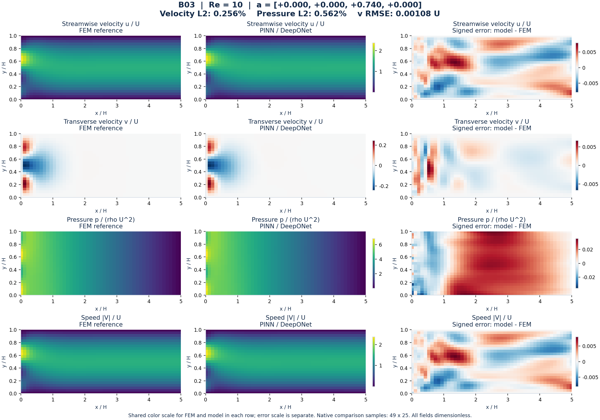
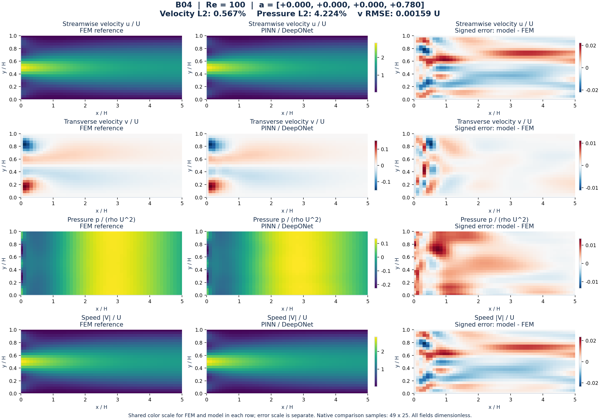
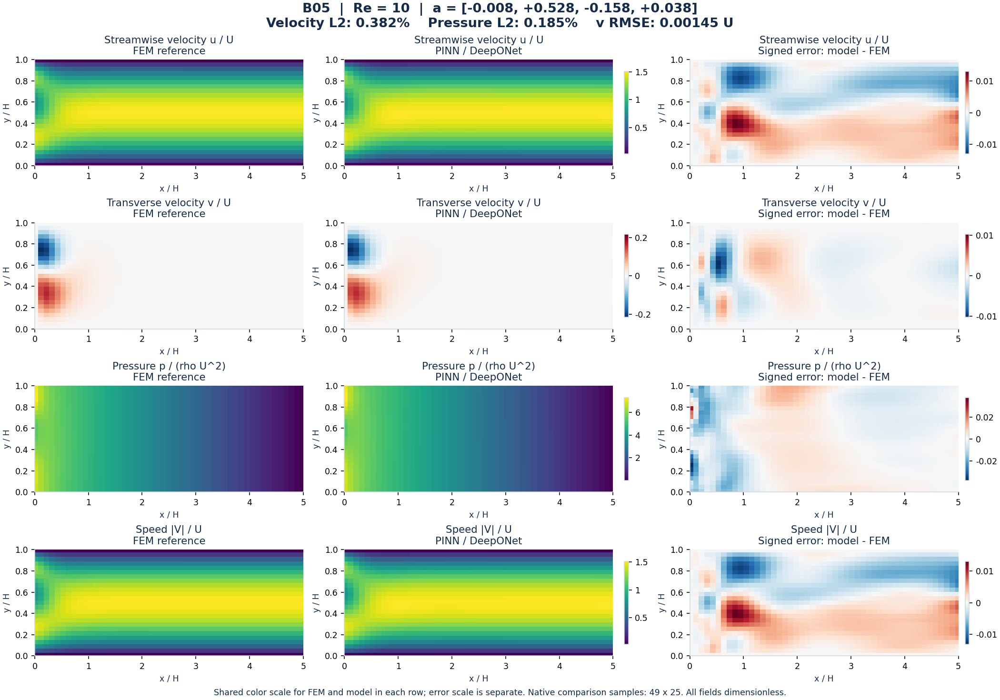
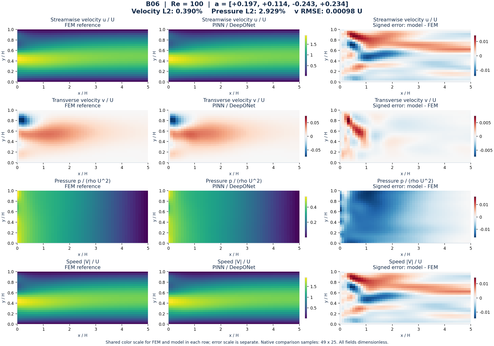
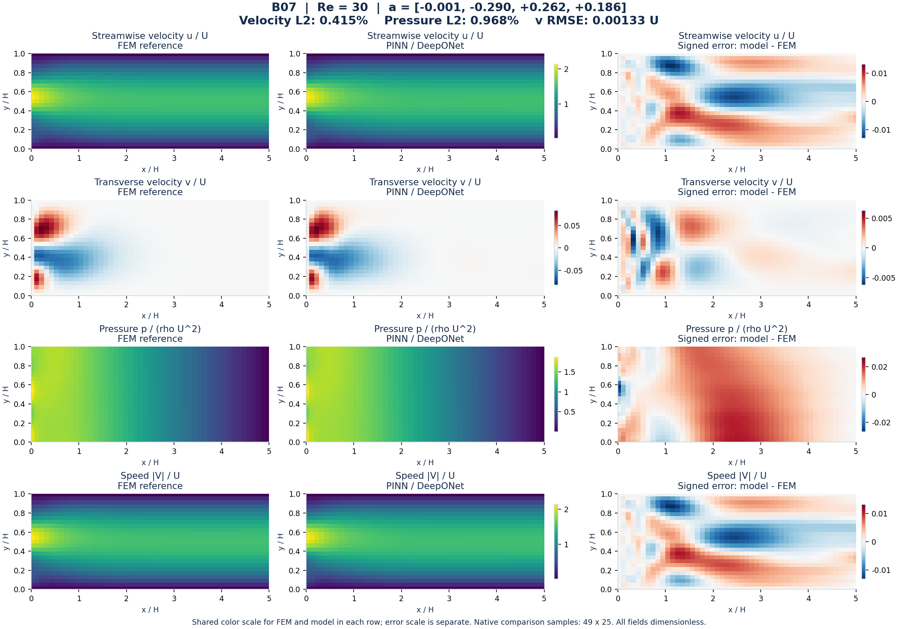
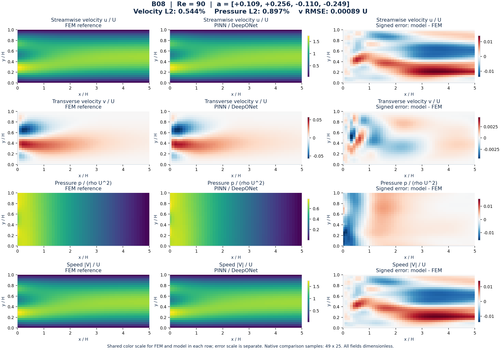

# مقایسهٔ تصویری مدل ثابت با حل عددی مرجع

تمام **۲۴ حالت خارج از آموزش** نمایش داده شده‌اند: ۸ آزمون نهایی B و ۱۶ حالت پایش M. حالت‌های M در توسعه و انتخاب مدل بررسی شده‌اند؛ با آزمون نهایی B یکسان نیستند. مدل هیبریدی FEM + physics-informed DeepONet است و وزن‌های ۷۰هزارگامی در این گزارش تغییر نکرده‌اند.

[گزارش PDF، ۴۹ صفحه](comparison_atlas.pdf) · [داشبورد تعاملی آفلاین](dashboard.html) · [جدول خطاها](summary.csv) · [مقادیر نقطه‌ای مرجع، مدل و اختلاف](pointwise_fields.csv) · [تمام میدان‌ها در NPZ](all_fields.npz)

برای داشبورد، فایل HTML را دانلود و در مرورگر باز کنید؛ تصاویر در خود فایل قرار دارند. GitHub آن را مستقیماً اجرا نمی‌کند.



## روش مقایسه

- مرجع: حل عددی اجزای محدود Taylor–Hood؛ مقایسه روی نقاط اصلی ذخیره‌شدهٔ ۴۹×۲۵، نه اندازهٔ مش FEM.
- میدان‌های u، v، p و اندازهٔ سرعت برای هر حالت: مرجع، مدل و اختلاف علامت‌دار، با مقیاس یکسان مرجع و مدل.
- مقاطع u، v و p در چهار موقعیت کانال؛ موقعیت واقعی نزدیک‌ترین نمونه روی نمودار نوشته شده است.
- خطای نسبی L2 از نسبت نرم اختلاف به نرم مرجع روی همین نقاط محاسبه شده است؛ خطای سرعت برای بردار (u,v) است.
- هیچ جابه‌جایی دلخواه فشار، هموارسازی مرجع یا آموزش مجدد برای ورودی آزمون انجام نشده است.
- به علت کوچک‌بودن مؤلفهٔ v، خطای نسبی آن را همراه RMSE مطلق ببینید.

مقاطع فشار می‌توانند اختلاف‌ها و نوسان‌های موضعی را آشکار کنند که در خطای کلی L2 کوچک به نظر می‌رسند؛ برای مثال B04 را ببینید.

**محدودیت:** معیار سخت‌گیرانهٔ مومنتوم هنوز در بعضی حالت‌ها پاس نشده است. مقادیر مومنتوم از ارزیابی ثبت‌شدهٔ همین checkpoint نقل شده‌اند. این نتایج محدود به خانوادهٔ چهارمودی، Re بین ۱۰ و ۱۰۰ و هندسهٔ کانال ۵×۱ هستند.

## تمام حالت‌ها

| حالت | Re | خطای بردار سرعت ٪ | خطای u ٪ | خطای v ٪ | RMSE مؤلفه v | خطای فشار ٪ | مومنتوم RMS | نمودار |
|---|---:|---:|---:|---:|---:|---:|---:|---|
| B01 | 100 | 0.483 | 0.475 | 3.518 | 0.00098 | 0.670 | 0.03017 | [میدان](cases/B01_fields.png) · [مقاطع](cases/B01_profiles.png) |
| B02 | 100 | 0.316 | 0.309 | 5.605 | 0.00072 | 1.412 | 0.03222 | [میدان](cases/B02_fields.png) · [مقاطع](cases/B02_profiles.png) |
| B03 | 10 | 0.256 | 0.236 | 2.644 | 0.00108 | 0.562 | 0.08530 | [میدان](cases/B03_fields.png) · [مقاطع](cases/B03_profiles.png) |
| B04 | 100 | 0.567 | 0.551 | 7.042 | 0.00159 | 4.224 | 0.05896 | [میدان](cases/B04_fields.png) · [مقاطع](cases/B04_profiles.png) |
| B05 | 10 | 0.382 | 0.357 | 4.800 | 0.00145 | 0.185 | 0.06947 | [میدان](cases/B05_fields.png) · [مقاطع](cases/B05_profiles.png) |
| B06 | 100 | 0.390 | 0.380 | 6.302 | 0.00098 | 2.929 | 0.02614 | [میدان](cases/B06_fields.png) · [مقاطع](cases/B06_profiles.png) |
| B07 | 30 | 0.415 | 0.397 | 7.573 | 0.00133 | 0.968 | 0.04456 | [میدان](cases/B07_fields.png) · [مقاطع](cases/B07_profiles.png) |
| B08 | 90 | 0.544 | 0.538 | 6.680 | 0.00089 | 0.897 | 0.02146 | [میدان](cases/B08_fields.png) · [مقاطع](cases/B08_profiles.png) |
| M01 | 10 | 0.295 | 0.249 | 4.071 | 0.00172 | 0.273 | 0.05313 | [میدان](cases/M01_fields.png) · [مقاطع](cases/M01_profiles.png) |
| M02 | 100 | 0.367 | 0.362 | 2.954 | 0.00067 | 0.767 | 0.02270 | [میدان](cases/M02_fields.png) · [مقاطع](cases/M02_profiles.png) |
| M03 | 10 | 0.272 | 0.232 | 3.673 | 0.00155 | 0.314 | 0.05387 | [میدان](cases/M03_fields.png) · [مقاطع](cases/M03_profiles.png) |
| M04 | 100 | 0.325 | 0.316 | 3.852 | 0.00087 | 0.844 | 0.02371 | [میدان](cases/M04_fields.png) · [مقاطع](cases/M04_profiles.png) |
| M05 | 10 | 0.155 | 0.139 | 3.120 | 0.00073 | 0.369 | 0.05222 | [میدان](cases/M05_fields.png) · [مقاطع](cases/M05_profiles.png) |
| M06 | 100 | 0.263 | 0.258 | 5.538 | 0.00059 | 1.014 | 0.02496 | [میدان](cases/M06_fields.png) · [مقاطع](cases/M06_profiles.png) |
| M07 | 10 | 0.217 | 0.194 | 3.027 | 0.00105 | 0.247 | 0.05853 | [میدان](cases/M07_fields.png) · [مقاطع](cases/M07_profiles.png) |
| M08 | 100 | 0.452 | 0.441 | 5.925 | 0.00107 | 0.683 | 0.02860 | [میدان](cases/M08_fields.png) · [مقاطع](cases/M08_profiles.png) |
| M09 | 10 | 0.167 | 0.145 | 2.702 | 0.00090 | 0.638 | 0.07498 | [میدان](cases/M09_fields.png) · [مقاطع](cases/M09_profiles.png) |
| M10 | 100 | 0.500 | 0.486 | 5.551 | 0.00131 | 2.065 | 0.03547 | [میدان](cases/M10_fields.png) · [مقاطع](cases/M10_profiles.png) |
| M11 | 10 | 0.230 | 0.216 | 2.625 | 0.00087 | 0.478 | 0.06984 | [میدان](cases/M11_fields.png) · [مقاطع](cases/M11_profiles.png) |
| M12 | 100 | 0.420 | 0.411 | 4.240 | 0.00100 | 1.501 | 0.03229 | [میدان](cases/M12_fields.png) · [مقاطع](cases/M12_profiles.png) |
| M13 | 10 | 0.164 | 0.149 | 2.992 | 0.00073 | 0.291 | 0.07519 | [میدان](cases/M13_fields.png) · [مقاطع](cases/M13_profiles.png) |
| M14 | 100 | 0.441 | 0.432 | 7.489 | 0.00096 | 1.037 | 0.03803 | [میدان](cases/M14_fields.png) · [مقاطع](cases/M14_profiles.png) |
| M15 | 10 | 0.291 | 0.269 | 4.488 | 0.00120 | 0.525 | 0.07783 | [میدان](cases/M15_fields.png) · [مقاطع](cases/M15_profiles.png) |
| M16 | 100 | 0.427 | 0.418 | 6.081 | 0.00101 | 1.361 | 0.04388 | [میدان](cases/M16_fields.png) · [مقاطع](cases/M16_profiles.png) |

## تصاویر هر هشت آزمون نهایی

### B01 — Re=100

ضرایب ورودی: `+0.7300, +0.0000, +0.0000, +0.0000`



[مقایسهٔ مقاطع این حالت](cases/B01_profiles.png)

### B02 — Re=100

ضرایب ورودی: `+0.0000, -0.7600, +0.0000, +0.0000`



[مقایسهٔ مقاطع این حالت](cases/B02_profiles.png)

### B03 — Re=10

ضرایب ورودی: `+0.0000, +0.0000, +0.7400, +0.0000`



[مقایسهٔ مقاطع این حالت](cases/B03_profiles.png)

### B04 — Re=100

ضرایب ورودی: `+0.0000, +0.0000, +0.0000, +0.7800`



[مقایسهٔ مقاطع این حالت](cases/B04_profiles.png)

### B05 — Re=10

ضرایب ورودی: `-0.0083, +0.5281, -0.1577, +0.0376`



[مقایسهٔ مقاطع این حالت](cases/B05_profiles.png)

### B06 — Re=100

ضرایب ورودی: `+0.1966, +0.1142, -0.2434, +0.2343`



[مقایسهٔ مقاطع این حالت](cases/B06_profiles.png)

### B07 — Re=30

ضرایب ورودی: `-0.0009, -0.2900, +0.2617, +0.1863`



[مقایسهٔ مقاطع این حالت](cases/B07_profiles.png)

### B08 — Re=90

ضرایب ورودی: `+0.1088, +0.2562, -0.1103, -0.2485`



[مقایسهٔ مقاطع این حالت](cases/B08_profiles.png)

## بازتولید

```bash
pip install -r requirements.txt
python scripts/render_v2_comparisons.py
```

هش وزن ثابت: `7db6b073a829529b7404fdf7ac9c7209c728af32f0e4d88be54e12a16bae282a`. تطابق خطاهای میدان با گزارش قبلی برای هر ۲۴ حالت کنترل شده است.
