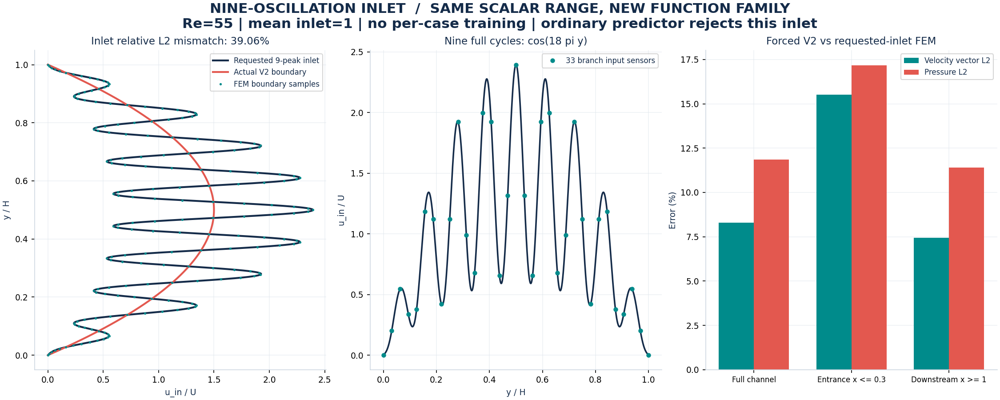
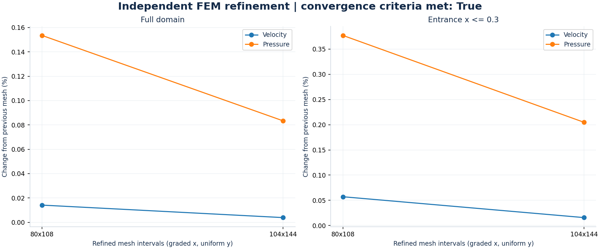
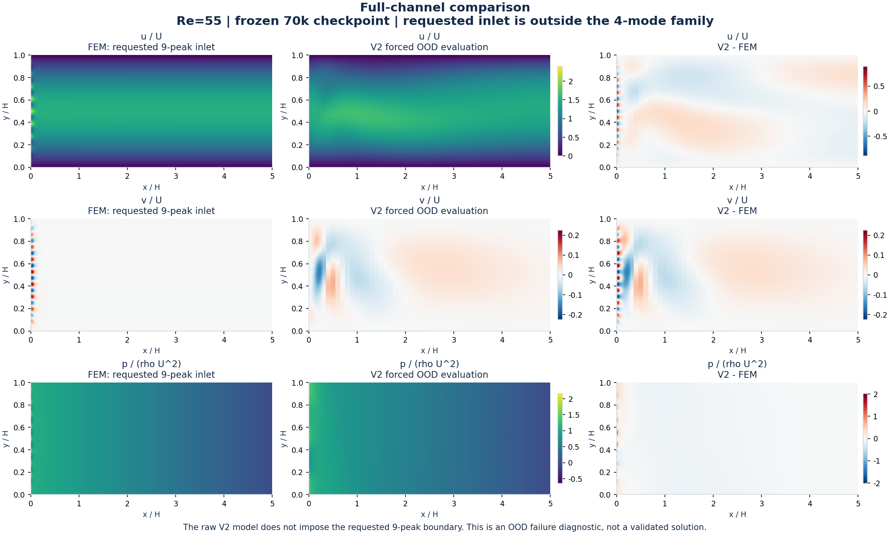
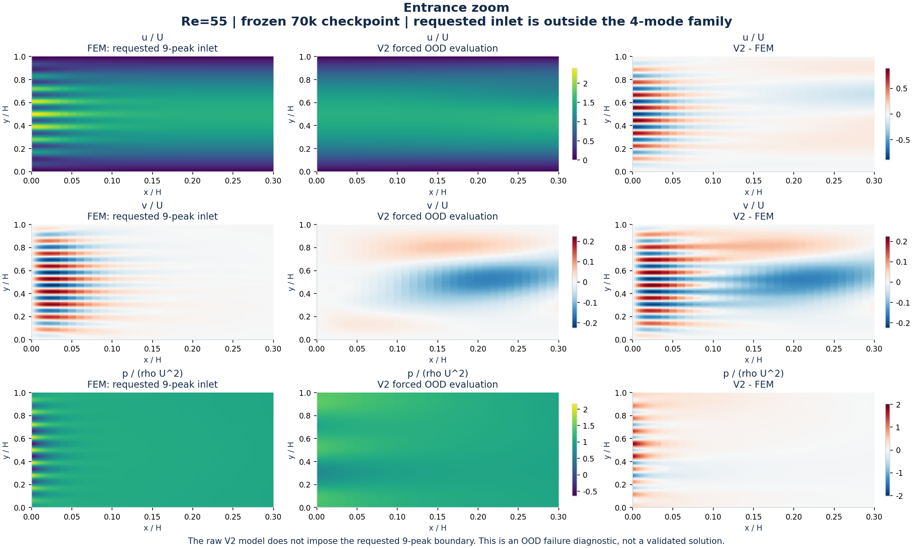
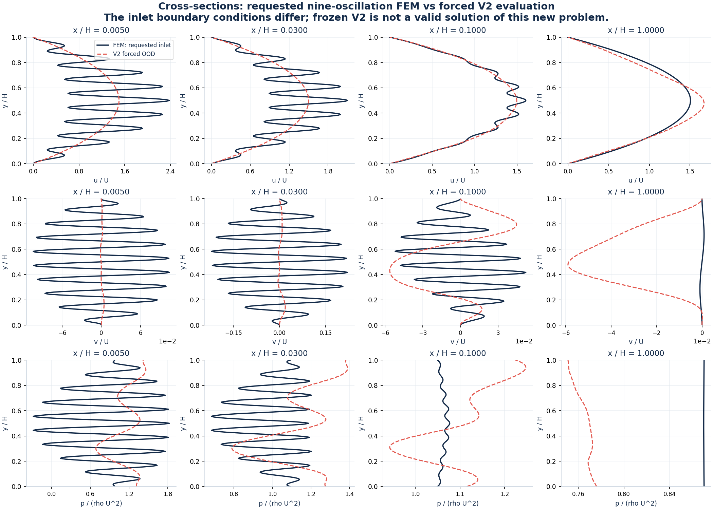

# آزمایش پروفایل ورودی با ۹ نوسان کامل

این آزمایش **۹ قلهٔ سرعت در عرض کانال** دارد؛ منظور ۹ سیکل کامل است، نه مود cos(9πy) که فقط ۴٫۵ سیکل دارد.

`u_in(y) = 6 y (1-y) [1 - 0.6 cos(18πy)] / [1 + 7.2/(18π)²]`

Re=55، میانگین ورودی ۱، کمینه صفر و بیشینه **2.3946** است. بیشینهٔ نمونه‌های ورودی آموزشی 2.8748 است.
دامنهٔ سرعت و Re در بازهٔ قبلی هستند، ولی **فرکانس و خانوادهٔ تابع ورودی خارج از دامنهٔ آموزش چهارمودی‌اند**.

## نتیجهٔ اصلی

این CSV از پیش‌بینی‌کنندهٔ معمول عبور نمی‌کند: [متن خطا](predictor_rejection.txt).
با اینکه تابع واقعی نامنفی است، بازسازی cubic spline از ۳۳ حسگر نزدیک دیواره به کمینهٔ -0.02152 می‌رسد و ابتدا کنترل نامنفی‌بودن شکست می‌خورد.
جدا از این مشکل نمونه‌برداری، خطای برازش چهارمودی روی حسگرها 39.05٪ است؛ بنابراین رفع overshoot هم پشتیبانی از این خانواده را فراهم نمی‌کند.
برای تشخیص محدودیت، همین ۳۳ نمونهٔ پروفایل بدون تغییر به شبکهٔ خام داده شدند؛ وزن‌ها ثابت ماندند.
معماری V2 در x=0 فقط تصویر چهارمودی پروفایل را اعمال می‌کند؛ بنابراین خطای شرط ورودی **39.06٪** است.
پس خروجی خام شبکه **حل معتبر مسئلهٔ ۹نوسانی نیست** و مقایسهٔ زیر یک آزمون شکست خارج از خانواده است، نه موفقیت تعمیم.
همچنین میدان‌های مقایسه‌شده شرط مرزی یکسان ندارند؛ این اختلاف عمداً اندازه‌گیری و آشکار شده است.



| ناحیه | خطای بردار سرعت ٪ | خطای فشار ٪ | خطای نسبی v ٪ | RMSE مؤلفه v نسبت به U |
|---|---:|---:|---:|---:|
| کل کانال | 8.287 | 11.844 | 230.911 | 0.02724 |
| ورودی x≤0.3 | 15.526 | 17.167 | 147.258 | 0.07089 |
| پایین‌دست x≥1 | 7.434 | 11.400 | 10575.894 | 0.01842 |

خطا با انتگرال‌گیری ذوزنقه‌ای روی مختصات واقعی شبکهٔ غیر یکنواخت محاسبه شده است؛ تراکم زیاد نمونه‌ها نزدیک ورودی، وزن کل آن ناحیه را مصنوعی زیاد نمی‌کند. فشار پس از حل جابه‌جا یا برازش نشده است.
خطای نسبی v در پایین‌دست بسیار بزرگ می‌شود چون خودِ v مرجع بسیار کوچک است؛ RMSE مطلق برای تفسیر این عدد کنار آن آمده است.

## مرجع عددی مستقل و بررسی مش

حل Taylor–Hood P2/P1 با شرط ورودی تحلیلیِ دقیق، دیوارهٔ بدون لغزش و خروجی طبیعی انجام شده است.
مش در جهت x نزدیک ورودی ریزتر است: `x_i=5(i/nx)^2`؛ جهت y یکنواخت است.
این اندازه‌ها تعداد بازه‌های مش‌اند؛ تعداد درجات آزادی P2/P1 بیشتر است.
معیار ریزسازی: اختلاف دو مش آخر در کل کانال کمتر از ۱٪ سرعت و ۲٪ فشار، و نزدیک ورودی کمتر از ۲٪ سرعت و ۳٪ فشار، با حداقل سه مش.
**وضعیت معیار ریزسازی: True.** این برآورد ریزسازی است، نه کران ریاضی خطا.
خطای درون‌یابی شرط ورودی FEM روی نقاط مقایسه: 0.0137٪.

| مش | تکرار Picard | باقی‌ماندهٔ جبری غیرخطی | تغییر سرعت نسبت به مش قبل ٪ | تغییر فشار نسبت به مش قبل ٪ |
|---|---:|---:|---:|---:|
| 64×72 | 13 | 1.18e-08 | — | — |
| 80×108 | 13 | 8.84e-09 | 0.014 | 0.153 |
| 104×144 | 13 | 6.79e-09 | 0.004 | 0.083 |



## مقایسهٔ میدان‌ها







## فایل‌ها و بازتولید

- [PDF پنج‌صفحه‌ای](nine_oscillations.pdf)
- [پروفایل ورودی CSV](inlet.csv)
- [اعداد و متادیتا](metrics.json)
- [میدان مدل و مرجع NPZ](comparison_fields.npz)
- [مقادیر نقطه‌ای CSV](pointwise_fields.csv)

```bash
python scripts/compare_nine_oscillations.py
```

وزن مدل تغییر نکرده است: `7db6b073a829529b7404fdf7ac9c7209c728af32f0e4d88be54e12a16bae282a`. هیچ داده یا پاسخی از این آزمایش برای آموزش استفاده نشده است.
برای پشتیبانی واقعی از چنین پروفایلی باید نمایش شرط مرزی و پوشش خانوادهٔ ورودی گسترش یابد و مدل دوباره به‌صورت عمومی آموزش و ارزیابی شود.
