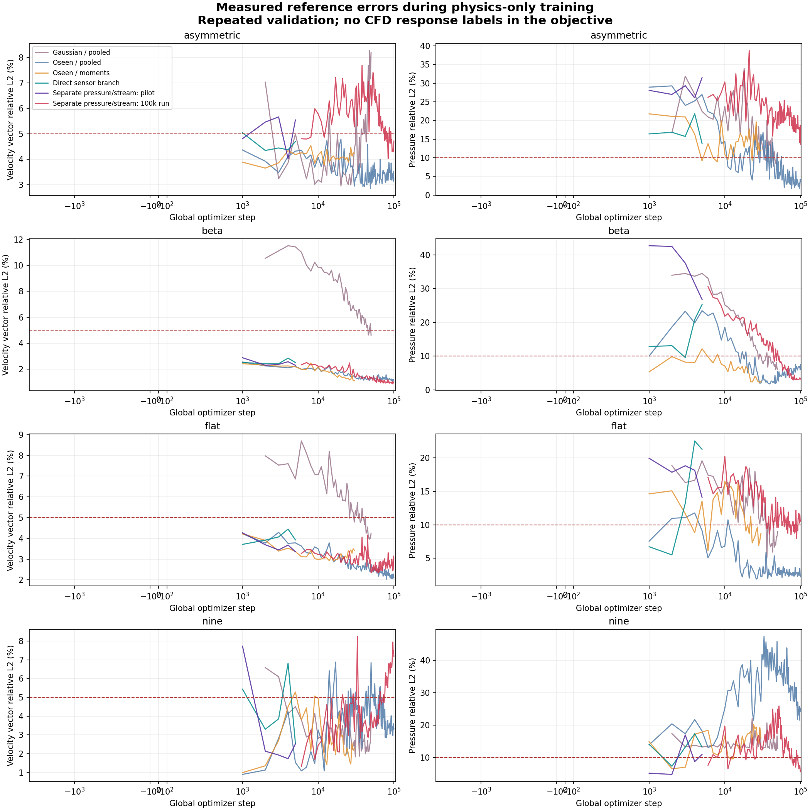
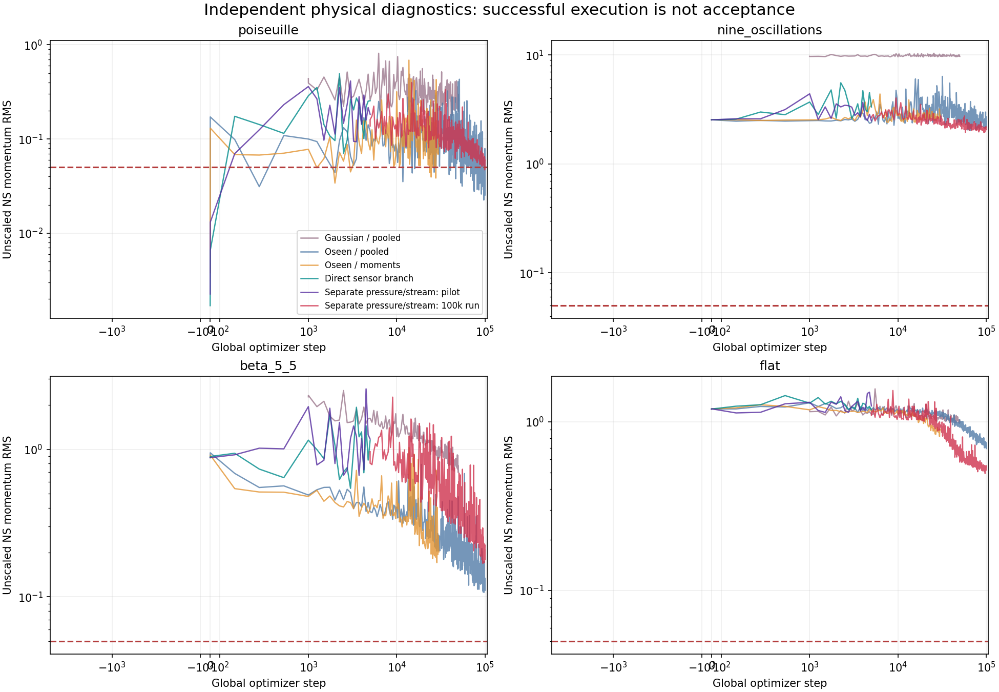

# نتایج واقعی آزمایش‌های اپراتور جدید

تمام اعداد این صفحه از checkpoint واقعی و مرجع مستقل آمده‌اند. این‌ها validation تکرارشونده‌اند؛ آزمون کور نهایی نیستند. پاسخ CFD وارد objective آموزش نشده است.

| آزمایش | گام وزن ارزیابی‌شده | بیشینهٔ خطای سرعت ٪ | بیشینهٔ خطای فشار ٪ | بیشینهٔ RMS مومنتوم | تمام معیارها پاس؟ |
|---|---:|---:|---:|---:|---|
| [Gaussian / pooled](gaussian/metrics.json) | 50000 | 8.207 | 12.824 | 9.9696 | False |
| [Oseen / pooled](oseen/metrics.json) | 100000 | 3.343 | 25.121 | 2.2763 | False |
| [Oseen / moments](moments/metrics.json) | 30000 | 4.222 | 15.870 | 2.7117 | False |
| [Direct sensor branch](sensor/metrics.json) | 5000 | 4.700 | 25.236 | 5.1709 | False |
| [Separate pressure/stream: pilot](pressure/metrics.json) | 5000 | 5.549 | 31.471 | 2.7280 | False |
| [Separate pressure/stream: 100k run](pressure_long/metrics.json) | 94000 | 6.604 | 17.845 | 2.0929 | False |

آزمایش‌ها فقط در یک عامل تغییر نکرده‌اند؛ از این جدول نمی‌توان سهم مستقل هر تغییر معماری، batch یا مقیاس‌بندی را استنتاج کرد. قیود ورودی و جرم در همهٔ نسخه‌های جدید برقرارند، اما این به‌تنهایی دقت میدان را تضمین نمی‌کند.

برای هر آزمایش، `training.jsonl`، متادیتای ورودی‌ها، SHA256 سورس و معیارهای رد/قبول نگه داشته شده‌اند. وزن‌های آزمایشی در `models/candidates/` قرار دارند؛ نامزدِ ردشده، مدل آمادهٔ استفاده نیست.

خطای بردار سرعت ممکن است ضعف مؤلفهٔ عرضیِ کوچک‌تر را پنهان کند. [CSV تمام حالت‌ها](case_errors.csv) خطای جداگانهٔ u و v و RMSE عرضی را هم دارد.

## Gaussian / pooled

نقشه‌های مرجع، مدل و اختلاف برای هر سه میدان:

[asymmetric](gaussian/asymmetric.png) | [beta](gaussian/beta.png) | [flat](gaussian/flat.png) | [nine](gaussian/nine.png)

## Oseen / pooled

نقشه‌های مرجع، مدل و اختلاف برای هر سه میدان:

[asymmetric](oseen/asymmetric.png) | [beta](oseen/beta.png) | [flat](oseen/flat.png) | [nine](oseen/nine.png)

## Oseen / moments

نقشه‌های مرجع، مدل و اختلاف برای هر سه میدان:

[asymmetric](moments/asymmetric.png) | [beta](moments/beta.png) | [flat](moments/flat.png) | [nine](moments/nine.png)

## Direct sensor branch

نقشه‌های مرجع، مدل و اختلاف برای هر سه میدان:

[asymmetric](sensor/asymmetric.png) | [beta](sensor/beta.png) | [flat](sensor/flat.png) | [nine](sensor/nine.png)

## Separate pressure/stream: pilot

نقشه‌های مرجع، مدل و اختلاف برای هر سه میدان:

[asymmetric](pressure/asymmetric.png) | [beta](pressure/beta.png) | [flat](pressure/flat.png) | [nine](pressure/nine.png)

## Separate pressure/stream: 100k run

نقشه‌های مرجع، مدل و اختلاف برای هر سه میدان:

[asymmetric](pressure_long/asymmetric.png) | [beta](pressure_long/beta.png) | [flat](pressure_long/flat.png) | [nine](pressure_long/nine.png)
