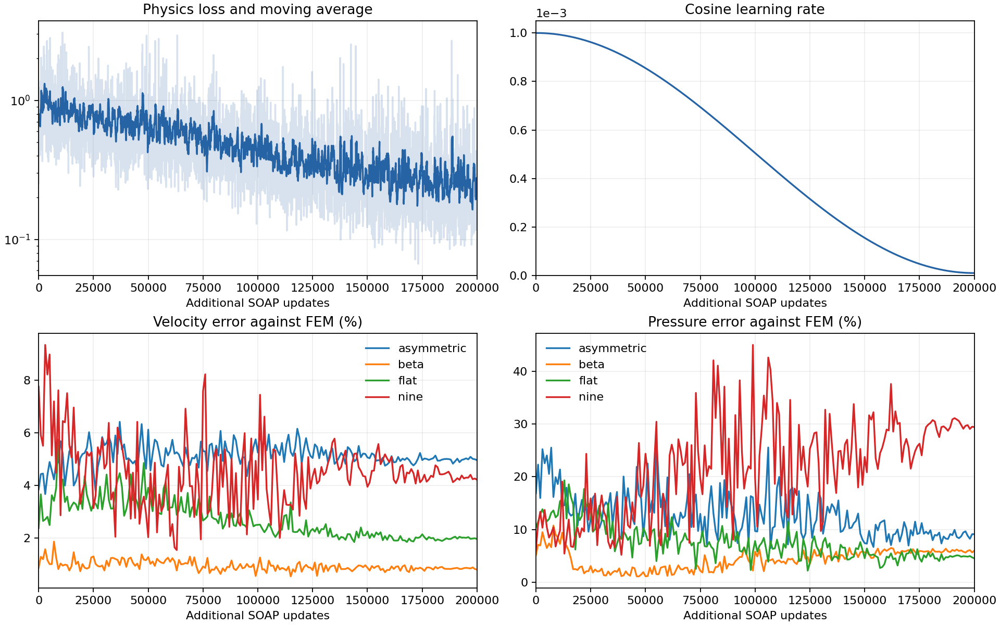

# SOAP cosine continuation

The run finished all 200,000 additional updates on Molab. It continued the full SOAP optimizer state at nominal step 114,000 and ended at step 314,000. The learning rate followed a cosine schedule from `1e-3` to `1e-5`. Training updates took 1.64 hours. The full invocation took 1.75 hours.

Mean physics loss across logged batches moved from 0.9103 in the first 10,000 updates to 0.2639 in the final 10,000 updates. The recorded validation score moved from 42.112 to 37.527.

| FEM case | Velocity L2 start | Velocity L2 final | Pressure L2 start | Pressure L2 final | Raw momentum RMS start | Raw momentum RMS final |
| --- | ---: | ---: | ---: | ---: | ---: | ---: |
| asymmetric | 3.84% | 4.96% | 16.85% | 9.11% | 0.1131 | 0.0859 |
| beta | 0.86% | 0.79% | 5.11% | 5.98% | 0.1158 | 0.1074 |
| flat | 2.37% | 1.96% | 10.34% | 4.51% | 0.4680 | 0.4485 |
| nine | 7.75% | 4.21% | 6.13% | 29.41% | 2.1056 | 1.8764 |

The FEM fields were used to calculate the four evaluation errors. The network trained on the physics objective using the input-only pool.

The final checkpoint failed these acceptance thresholds. `pressure_relative_l2`, `momentum_rms`.

- [Final weights and full optimizer state](final_checkpoint.npz)
- [Final portable archive](checkpoints/resume_200000.zip) with the parent checkpoint, source, configuration and restart instructions
- [Portable archives at every milestone](checkpoints)
- [Training log](training.jsonl), [validation history](validation_history.csv) and [final metrics](final_metrics.json)
- [Results for 14 smooth inlet cases](smooth_inlets/README.md), with inlet profiles, FEM references and error metrics
- [Run configuration](config.json), [completion status](status.json), [timings](summary.json) and [SHA-256 checksums](SHA256SUMS)

To resume from a milestone, extract its archive in a fresh run directory and follow [RESUME.txt](RESUME.txt). Each archive contains its update index, model parameters, SOAP moments and bases, and NumPy RNG state. The final archive represents an already completed schedule.
