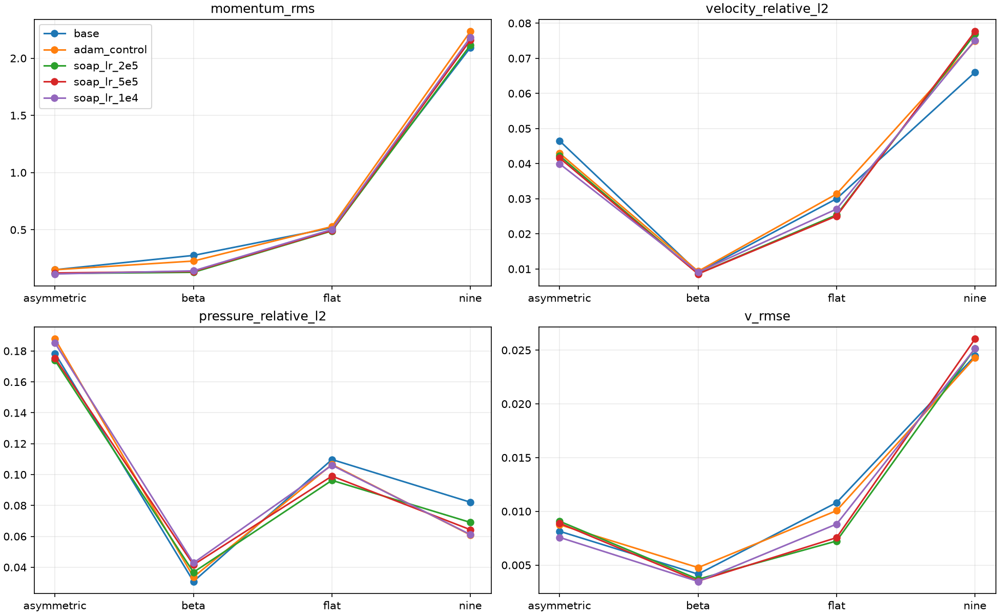

# Adam and SOAP screening

Each arm ran 5,000 updates from the same step-94,000 checkpoint. The archived endpoints contain the model parameters, optimizer state and RNG for that stage. The validation score is the worst ratio of a measured error to its threshold across the benchmark cases. Lower is better.

| Arm | Validation score | Training time (s) | Checkpoint |
| --- | ---: | ---: | --- |
| adam_control | 44.674 | 106.3 | [Full state](adam_control/checkpoint.npz) |
| soap_lr_2e5 | 42.290 | 140.3 | [Full state](soap_lr_2e5/checkpoint.npz) |
| soap_lr_5e5 | 43.169 | 141.2 | [Full state](soap_lr_5e5/checkpoint.npz) |
| soap_lr_1e4 | 43.653 | 144.2 | [Full state](soap_lr_1e4/checkpoint.npz) |

The selection rule advanced `soap_lr_2e5` to the longer comparison.

This directory covers the 5,000-update screen. The final SOAP checkpoint from the subsequent 20,000-update comparison is included as the parent in the [cosine continuation archive](../checkpoints/resume_200000.zip).

[Per-case comparison CSV](comparison.csv) · [Selection rules and results](selection.json) · [Source manifest](source_manifest.json)
