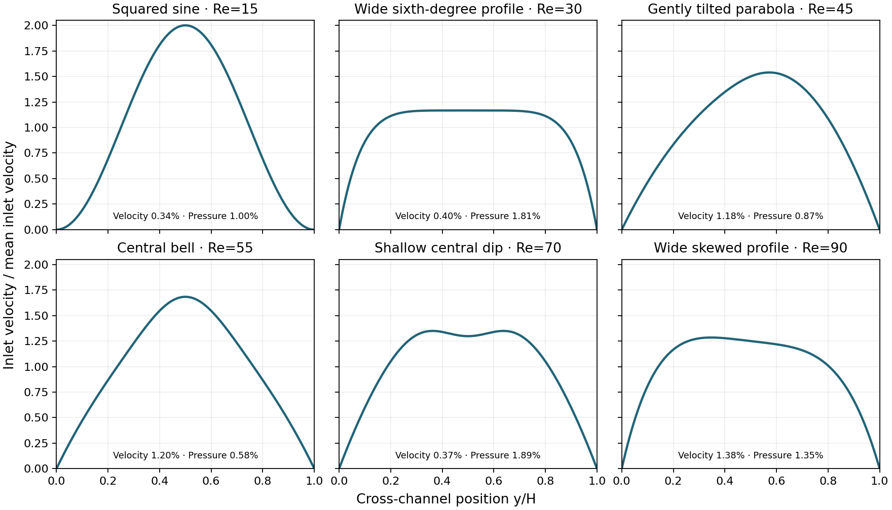

# Smooth inlet evaluation

The six new inlet shapes span Re=15 to Re=90. 6 of 6 met both the velocity and pressure limits, and 0 of 6 met all seven limits. Across the three smooth-inlet suites, 14 of 14 met the field error limits and 2 met all seven limits.

The frozen checkpoint is from nominal step 314,000. Each inlet is smooth, nonnegative, zero at the channel walls and normalized to unit flux. Independent Taylor–Hood FEM solutions were checked by comparing 32×24 and 48×36 meshes. The finer mesh supplies the field reference, with no fitted pressure shift. FEM data are used for evaluation.

The field limits are 5% relative L2 error in velocity and 10% relative L2 error in pressure. The raw momentum RMS limit is 0.05. These results apply to the listed smooth profiles. The original benchmark and its results are recorded in the [training report](../README.md).

| New profile | Re | Velocity L2 | Pressure L2 | Momentum RMS | Velocity and pressure | All seven |
| --- | ---: | ---: | ---: | ---: | --- | --- |
| Squared sine | 15 | 0.34% | 1.00% | 0.11247 | Pass | Fail |
| Wide sixth-degree profile | 30 | 0.40% | 1.81% | 0.07509 | Pass | Fail |
| Gently tilted parabola | 45 | 1.18% | 0.87% | 0.10286 | Pass | Fail |
| Central bell | 55 | 1.20% | 0.58% | 0.07458 | Pass | Fail |
| Shallow central dip | 70 | 0.37% | 1.89% | 0.05529 | Pass | Fail |
| Wide skewed profile | 90 | 1.38% | 1.35% | 0.08945 | Pass | Fail |



The [comparison CSV](comparison.csv) combines all 14 cases. Each suite contains the original metrics and the FEM reference arrays, including the sampled inlet, evaluation grid, fields and mesh refinement statistics.

Run the following from the repository root after installing the CPU and validation requirements. Use `--suite initial` or `--suite extended` to reproduce an earlier suite.

```sh
PYTHONPATH=. JAX_PLATFORMS=cpu OPENBLAS_NUM_THREADS=1 python \
  reports/experiments/soap_cosine_200k/smooth_inlets/evaluate.py \
  --checkpoint reports/experiments/soap_cosine_200k/final_checkpoint.npz \
  --suite diverse --output /tmp/soap-smooth-diverse
```
