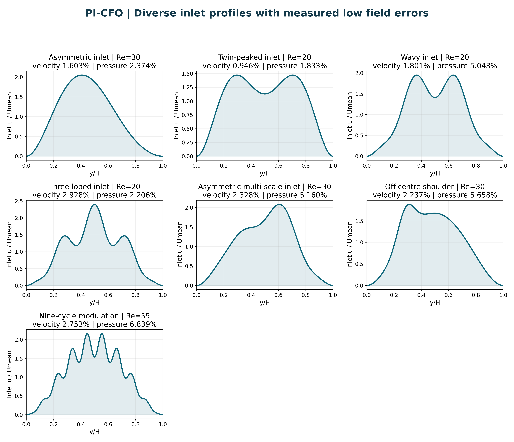
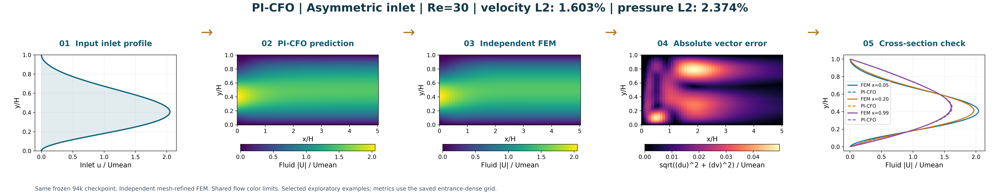
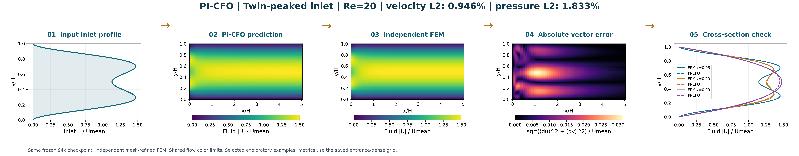
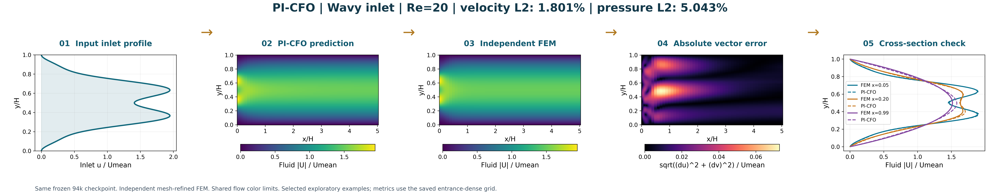
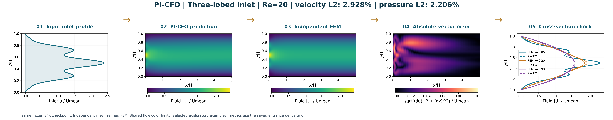
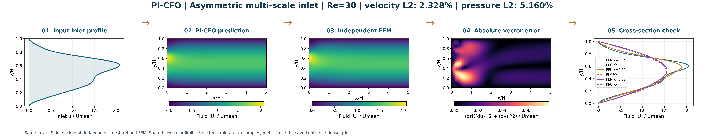
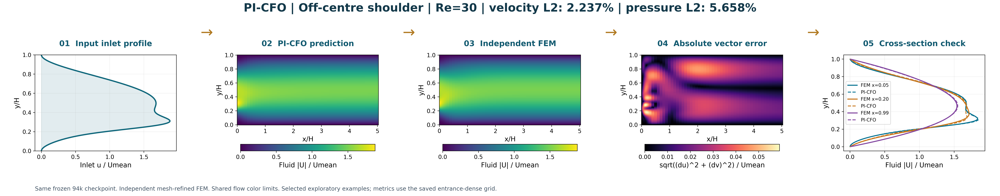
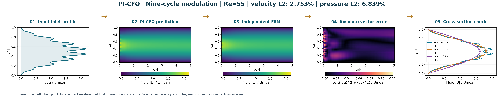

# پروفایل‌های متنوع‌تر و افزودن ورودی تخمینی به بازسازی از ذرات

## Beta(5,5) یعنی چه؟

این نام دو پارامتر شکل **۵ و ۵** را نشان می‌دهد، نه عدد اعشاری ۵٫۵. تابع بتای نرمال‌شده روی ارتفاع بی‌بعد کانال `0 ≤ y ≤ 1` به صورت زیر است:

`f(y) = y^(a-1) (1-y)^(b-1) / B(a,b)`

بنابراین `Beta(5,5) = 630 y^4 (1-y)^4` است: پروفایلی صاف، متقارن و زنگوله‌ای که روی دو دیواره صفر و میانگین آن یک است. این پروفایل سهمی نیست؛ سهمی نرمال‌شده `6y(1-y)` یا Beta(2,2) است. بزرگ‌شدن دو پارامتر مساوی، پروفایل را متمرکزتر می‌کند. در شکل‌های جدید نام توصیفی شکل‌ها به‌کار رفته تا خواندن آن‌ها ساده‌تر باشد.

## بخش اول: ورودی‌های واقعاً متفاوت با خطای اندازه‌گیری‌شده

همان وزن‌های ثابت مدل **PI-CFO** در گام ۹۴۰۰۰ استفاده شده‌اند؛ آموزش مجدد یا اصلاح وزن‌ها انجام نشده است. نام PI-CFO به اپراتور جریان کانالِ اصلاح‌شده در این پروژه اشاره دارد. پایهٔ معماری، DeepONet فیزیک‌آگاه است و نسبت‌دادن ایدهٔ اصلی DeepONet به این پروژه منظور نیست.

هر تصویر پنج پنل در یک ردیف دارد: **پروفایل ورودی → پیش‌بینی شبکه → FEM مستقل → نقشهٔ خطای برداری سرعت → مقایسهٔ برش‌های جریان**. رنگ‌بندی شبکه و FEM یکسان است. برای خطای نقطه‌ای از اندازهٔ بردار اختلاف سرعت استفاده شده، نه تفاضل اندازه‌های سرعت که ممکن است اختلاف جهت را پنهان کند.

[گالری پروفایل‌های منتخب](profile_gallery.png) · [PDF همهٔ شکل‌های جدید](all_new_figures.pdf) · [بستهٔ کامل](diverse_results_package.zip)



| نوع ورودی | Re | خطای سرعت برداری | خطای فشار | قلهٔ برجسته |
|---|---:|---:|---:|---:|
| نامتقارن | 30 | 1.603٪ | 2.374٪ | 1 |
| دو‌قله‌ای | 20 | 0.946٪ | 1.833٪ | 2 |
| موج‌دار | 20 | 1.801٪ | 5.043٪ | 2 |
| سه‌قله‌ای | 20 | 2.928٪ | 2.206٪ | 3 |
| نامتقارن چندمقیاسی | 30 | 2.328٪ | 5.160٪ | 1 |
| برآمدگی خارج از مرکز | 30 | 2.237٪ | 5.658٪ | 1 |
| مدولاسیون ۹ دوره‌ای | 55 | 2.753٪ | 6.839٪ | 6 |

انتخاب نمونه‌ها توسعه‌ای و پس از محاسبهٔ خطاست. شرط ورود به مجموعه، خطای نسبی L2 سرعت برداری کمتر از ۵٪ و فشار کمتر از ۱۰٪، همراه با بررسی تغییر مش مرجع است. از هر خانواده یک نمونه انتخاب شده است؛ معیار ترجیح، کمینه‌کردن بزرگ‌ترین خطای نرمال‌شده به این دو آستانه است. تمام تلاش‌ها، از جمله حالت‌های انتخاب‌نشده، در جدول پایین و `sweep.json` نگه داشته شده‌اند. این مثال‌های منتخب، تضمین دقت برای هر ورودی یا قبولی تمام معیارهای فیزیکی مدل نیستند.

«مدولاسیون ۹ دوره‌ای» یعنی ضریب کسینوسی `cos(18*pi*y)` در کل ارتفاع ۹ دوره دارد؛ پس از ضرب در پوشِ صفرشونده روی دیواره، همهٔ آن‌ها الزاماً قلهٔ برجستهٔ جداگانه نیستند. تعداد قله‌های برجستهٔ پروفایل نهایی نیز جداگانه در جدول گزارش شده است.

مرجع، FEM مستقل Taylor–Hood با سرعت P2 و فشار P1 برای همان مسئلهٔ مرزی ناویر–استوکس پایا است. هیچ خروجی شبکه‌ای در تولید مرجع استفاده نشده است. مش در جهت طولی نزدیک ورودی ریز شده؛ موارد قابل انتخاب روی دو مش محاسبه شده‌اند و تغییر مرجع باید برای سرعت کمتر از ۱٪ و فشار کمتر از ۲٪ باشد. خطای گزارش‌شده روی ۷۰۸۱ نقطه با تراکم بیشتر نزدیک ورودی محاسبه می‌شود؛ این نرم نمونه‌ای است و انتگرال وزن‌دار مساحت نیست. فشار بدون جابه‌جایی برای کاهش خطا مقایسه شده است. اعداد روی تصویر مربوط به کل این شبکهٔ ارزیابی هستند، نه فقط برش‌های پنل آخر.

### نامتقارن — Re=30

فرمول: `normalize(y^2*(1-y)^2*(1+0.6*cos(pi*y)))`؛ normalize یعنی میانگین ارتفاعی یک. ورودی، اسپلاین C2 از ۲۵۷ نمونهٔ این تابع است.



[PNG اصلی](forward/skew_b3.png) · [PDF برداری](forward/skew_b3.pdf)

### دو‌قله‌ای — Re=20

فرمول: `normalize(y^2*(1-y)^2*(1+0.55*cos(2*pi*y)))`؛ normalize یعنی میانگین ارتفاعی یک. ورودی، اسپلاین C2 از ۲۵۷ نمونهٔ این تابع است.



[PNG اصلی](forward/twin_b3_r20.png) · [PDF برداری](forward/twin_b3_r20.pdf)

### موج‌دار — Re=20

فرمول: `normalize(y^2*(1-y)^2*(1+0.25*cos(6*pi*y)))`؛ normalize یعنی میانگین ارتفاعی یک. ورودی، اسپلاین C2 از ۲۵۷ نمونهٔ این تابع است.



[PNG اصلی](forward/waves3_r20.png) · [PDF برداری](forward/waves3_r20.pdf)

### سه‌قله‌ای — Re=20

فرمول: `normalize(y^2*(1-y)^2*(1+0.28*cos(8*pi*y)))`؛ normalize یعنی میانگین ارتفاعی یک. ورودی، اسپلاین C2 از ۲۵۷ نمونهٔ این تابع است.



[PNG اصلی](forward/lobes4_r20.png) · [PDF برداری](forward/lobes4_r20.pdf)

### نامتقارن چندمقیاسی — Re=30

فرمول: `normalize(y^2*(1-y)^2*(1+0.18*sin(4*pi*y)+0.10*cos(6*pi*y)))`؛ normalize یعنی میانگین ارتفاعی یک. ورودی، اسپلاین C2 از ۲۵۷ نمونهٔ این تابع است.



[PNG اصلی](forward/mixed.png) · [PDF برداری](forward/mixed.pdf)

### برآمدگی خارج از مرکز — Re=30

فرمول: `normalize(y^2*(1-y)^2*(1+0.65*exp(-((y-0.27)/0.09)**2)))`؛ normalize یعنی میانگین ارتفاعی یک. ورودی، اسپلاین C2 از ۲۵۷ نمونهٔ این تابع است.



[PNG اصلی](forward/shoulder.png) · [PDF برداری](forward/shoulder.pdf)

### مدولاسیون ۹ دوره‌ای — Re=55

فرمول: `normalize(y^2*(1-y)^2*(1+0.18*cos(18*pi*y)))`؛ normalize یعنی میانگین ارتفاعی یک. ورودی، اسپلاین C2 از ۲۵۷ نمونهٔ این تابع است.



[PNG اصلی](forward/nine.png) · [PDF برداری](forward/nine.pdf)

## بخش دوم: پروفایل ورودیِ تخمین‌زده‌شده هم دیده می‌شود

هر ردیف جدید شش پنل دارد: **دو مسیر ورودی → پروفایل ورودی تخمینی → میدان سرعت تخمینی → حرکت ذرات در همان میدان → هم‌پوشانی مسیرها → خطای مکانی در زمان یکسان**. علاوه بر آن، برای هر مثال یک تصویر مستقل از ورودی تخمینی آماده شده است.

پروفایل پنل دوم مستقیماً از مقادیر ذخیره‌شدهٔ `inlet_normalized.csv` و سرعت میانگین تخمینی خوانده می‌شود؛ این شکل، پروفایل حقیقی پنهانیِ سازندهٔ داده‌ها نیست. هیچ برازش مجددی انجام نشده و مسیر خروجی همان حل مستقل ODE ذرات در جریان تخمینی ذخیره‌شده است. نزدیک‌بودن مسیرها، دقت یا یکتایی بازسازی کل میدان را ثابت نمی‌کند؛ دو مسیر، اطلاعات محدودی از کل میدان می‌دهند. معیار این بخش، بازتولید مسیرهای استفاده‌شده در برازش است و آزمون مسیر کاملاً ندیده محسوب نمی‌شود.

### Oblique launches


ذرهٔ 1: RMSE دوبعدی 0.2685٪ ارتفاع کانال؛ ذرهٔ 2: RMSE دوبعدی 0.1414٪ ارتفاع کانال

[ردیف شش‌پنلی PNG](inverse/oblique_beta5.png) · [PDF برداری](inverse/oblique_beta5.pdf) · [تصویر مستقل پروفایل ورودی](inverse/oblique_beta5_inlet.png)

### Corner launches / experiment A


ذرهٔ 1: RMSE دوبعدی 0.0944٪ ارتفاع کانال؛ ذرهٔ 2: RMSE دوبعدی 0.0682٪ ارتفاع کانال

[ردیف شش‌پنلی PNG](inverse/corners_beta5.png) · [PDF برداری](inverse/corners_beta5.pdf) · [تصویر مستقل پروفایل ورودی](inverse/corners_beta5_inlet.png)

### Corner launches / experiment B


ذرهٔ 1: RMSE دوبعدی 0.0628٪ ارتفاع کانال؛ ذرهٔ 2: RMSE دوبعدی 0.0533٪ ارتفاع کانال

[ردیف شش‌پنلی PNG](inverse/corners_beta4.png) · [PDF برداری](inverse/corners_beta4.pdf) · [تصویر مستقل پروفایل ورودی](inverse/corners_beta4_inlet.png)

## تمام حالت‌های بررسی‌شده

| نام پرونده | Re | سرعت L2 | فشار L2 | تغییر مش سرعت | تغییر مش فشار | در شکل‌های منتخب |
|---|---:|---:|---:|---:|---:|---|
| skew_b3 | 30 | 1.603٪ | 2.374٪ | 0.0014٪ | 0.0143٪ | بله |
| skew_b4 | 30 | 1.774٪ | 2.444٪ | 0.0016٪ | 0.0189٪ | خیر |
| twin_b3_r20 | 20 | 0.946٪ | 1.833٪ | 0.0030٪ | 0.0206٪ | بله |
| twin_b3_r30 | 30 | 0.838٪ | 4.481٪ | 0.0029٪ | 0.0198٪ | خیر |
| twin_b4 | 30 | 1.212٪ | 4.622٪ | 0.0037٪ | 0.0277٪ | خیر |
| lobes4_r20 | 20 | 2.928٪ | 2.206٪ | 0.0040٪ | 0.0547٪ | بله |
| lobes4_r30 | 30 | 3.198٪ | 2.599٪ | 0.0038٪ | 0.0533٪ | خیر |
| waves3_r20 | 20 | 1.801٪ | 5.043٪ | 0.0022٪ | 0.0275٪ | بله |
| waves3_r30 | 30 | 1.434٪ | 5.468٪ | 0.0020٪ | 0.0266٪ | خیر |
| mixed | 30 | 2.328٪ | 5.160٪ | 0.0012٪ | 0.0162٪ | بله |
| nine | 55 | 2.753٪ | 6.839٪ | 0.0131٪ | 0.2544٪ | بله |
| shoulder | 30 | 2.237٪ | 5.658٪ | 0.0043٪ | 0.0340٪ | بله |

## کیفیت خروجی و بازتولید

PNGها با وضوح ۳۲۰dpi ذخیره شده‌اند. ردیف‌های مستقیم ۸۶۴۰×۱۶۹۶ و ردیف‌های معکوس ۱۰۳۶۸×۱۶۹۶ پیکسل‌اند. برای اسلاید و بزرگ‌نمایی، PDFها برداری هستند. نسبت نمایش محورها برای قرارگرفتن کنار هم تنظیم شده است؛ مقادیر x/H و y/H ملاک هندسه‌اند. کانال واقعی طول ۵ و ارتفاع ۱ دارد.

فایل‌های مدل، حل‌گر، اسلایدها و نتایج قبلی تغییر نکرده‌اند. فایل‌های خام جدید، اطلاعات دو مش، معیارها، هش مدل و ورودی‌ها، و داده‌های لازم برای بازتولید شکل‌های ذرات در این پوشه موجودند. این بسته یک نسخهٔ جدید از مدل آموزش‌دیده نیست؛ شکل‌ها و آزمایش‌های جدید با همان مدل‌اند.

از ریشهٔ مخزن، در محیط پایتون با وابستگی‌های پروژه:

```bash
python results/diverse_profiles_2026_11_07/evaluate_profiles.py
python results/diverse_profiles_2026_11_07/build_figures.py
python results/diverse_profiles_2026_11_07/package_results.py
```

تولیدکنندهٔ FEM نتایج موجود را از پرونده‌ها می‌خواند. برای محاسبهٔ کامل مجدد، پوشهٔ data را ابتدا به محل دیگری منتقل کنید و سپس evaluate_profiles.py را اجرا کنید. بستهٔ ZIP شکل‌ها، جدول‌ها، کد و آرایه‌های عددی را دربرمی‌گیرد؛ وزن‌های مدل در مسیر اصلی مخزن نگهداری می‌شوند.
