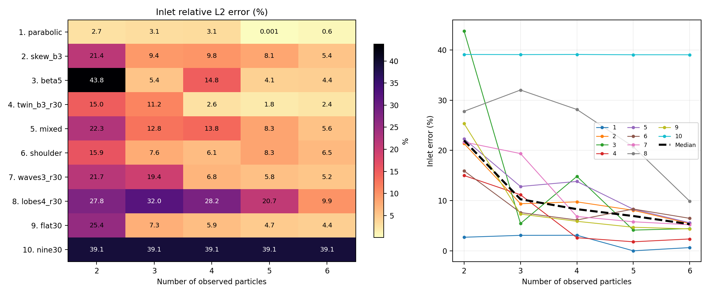
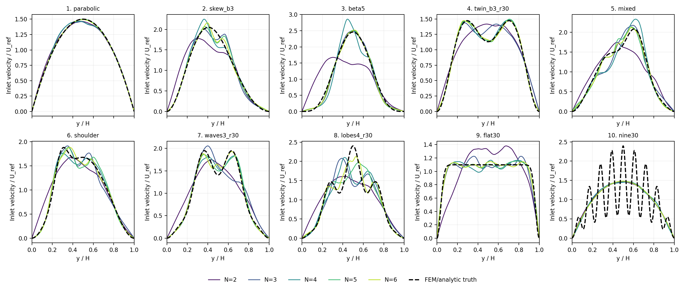

# اثر تعداد ذرات بر بازسازی پروفایل ورودی

رینولدز همهٔ پروفایل‌ها ۳۰ و سرعت میانگین حقیقی یک است.
هر ستون از همان ذرات ستون قبلی به‌اضافهٔ یک ذره استفاده می‌کند.
ترتیب برحسب RMS مشتق دوم ورودی است، نه فقط تعداد قله‌ها.
خطا، نرم نسبی پروفایل کامل در واحد سرعت مرجع است.

| پروفایل | ۲ ذره | ۳ ذره | ۴ ذره | ۵ ذره | ۶ ذره |
|---|---:|---:|---:|---:|---:|
| سهموی | 2.70% | 3.08% | 3.10% | 0.0009% | 0.64% |
| نامتقارن | 21.37% | 9.38% | 9.75% | 8.07% | 5.42% |
| بتای باریک | 43.81% | 5.43% | 14.83% | 4.12% | 4.43% |
| دوقله‌ای | 15.00% | 11.16% | 2.61% | 1.79% | 2.36% |
| چندمقیاسی | 22.31% | 12.82% | 13.82% | 8.28% | 5.58% |
| دارای شانه | 15.92% | 7.62% | 6.14% | 8.32% | 6.47% |
| سه‌نوسانی | 21.66% | 19.37% | 6.83% | 5.79% | 5.19% |
| چهارنوسانی | 27.79% | 32.04% | 28.16% | 20.73% | 9.88% |
| تقریباً تخت | 25.35% | 7.32% | 5.88% | 4.69% | 4.37% |
| نه‌نوسانی | 39.11% | 39.09% | 39.11% | 39.06% | 39.05% |

در 10 پروفایل، شش ذره بهتر از دو ذره بود.
از ۴۰ افزایش تک‌ذره‌ای، 29 مورد خطای کمتری داشت.
تعداد پروفایل‌های با بهبود کاملاً یکنواخت: 2.
میانهٔ خطا از 21.99% با دو ذره به 5.31% با شش ذره رسید.
تعداد جواب‌های منتخب با همگرایی تأییدشدهٔ بهینه‌ساز: 0 از ۵۰.
بودجهٔ همهٔ حالت‌ها دو شروع و حداکثر ۲۰۰ تکرار برای هر شروع بود.
بنابراین نتایج، غربالگری با بودجهٔ محدود هستند؛ کمینهٔ بهینه‌سازی تضمین نشده است.

این یک آزمون عددی مشروط به مدل منجمد و چیدمان معلوم است.
افزایش تعداد ذرات، تعداد نمونه‌ها و پوشش مکانی را هم‌زمان افزایش می‌دهد.
هر ذره ۸۱ مشاهده دارد؛ دو شروع، عدم‌قطعیت آماری را تعیین نمی‌کنند.
نویز ثابت، همان تحقق نویز را در همهٔ پیشوندها حفظ می‌کند.
پروفایل حقیقی فقط برای ارزیابی نهایی استفاده شده است.
پروفیل سهموی با حدس اولیه و پیشین هموارسازی منطبق است؛ خطای کم آن فقط اثر تعداد ذرات نیست.
انتخاب شروع با تابع هدف انجام شد، نه با خطای پروفایل حقیقی.
خطای عملگر مستقیم، نویز، منظم‌سازی و بودجهٔ محدود می‌توانند مانع بهبود شوند.
شروع‌های ناموفق و توقف‌های سقف تکرار در گزارش هر حالت محفوظ‌اند.
مقایسهٔ همهٔ حالت‌ها در `summary.csv` و گزارش‌های `fits/` موجود است.
