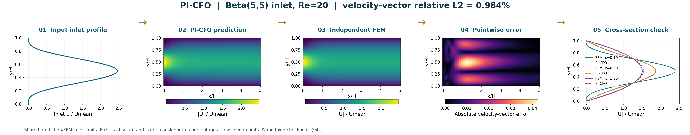
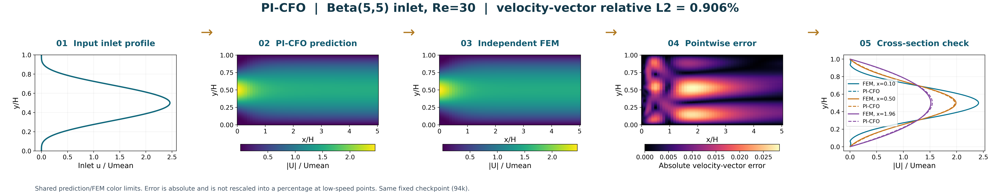
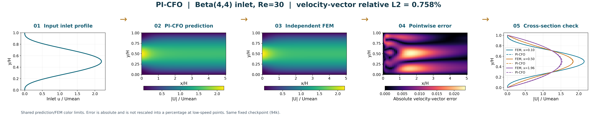
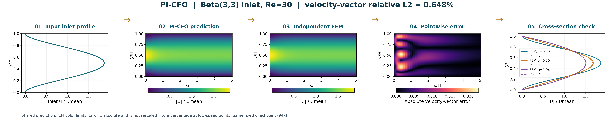
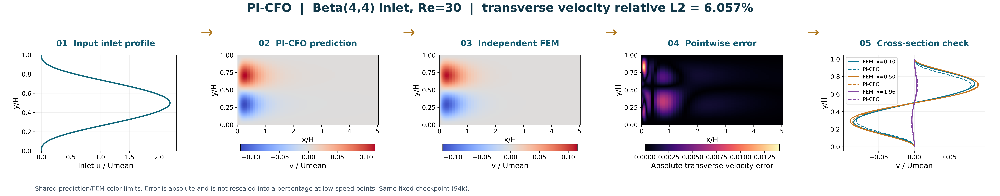
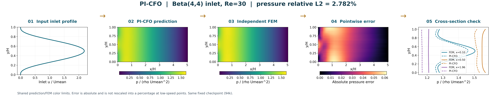
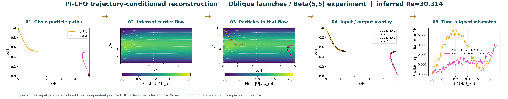
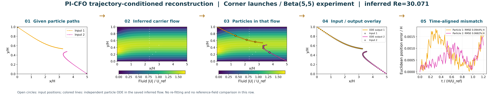
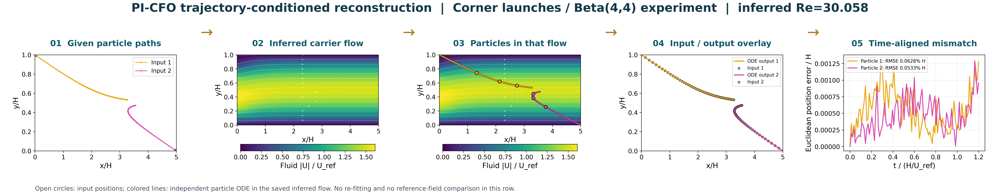

# ردیف‌های تصویری فرآیند: ورودی ← پیش‌بینی ← بررسی

نام نمایشی این مدلِ پروژه **PI-CFO — اپراتور فیزیک‌آگاه جریان کانال** است. این نام به پیاده‌سازی و اصلاحات این پروژه اشاره دارد؛ معماری بر پایهٔ DeepONet فیزیک‌آگاه است و ایدهٔ اصلی DeepONet به‌عنوان اختراع جدید معرفی نمی‌شود.

## ۱. حل مستقیم؛ هر تصویر پنج نمودار در یک ردیف

از چپ: پروفایل ورودی؛ کانتور پیش‌بینی PI-CFO؛ کانتور FEM؛ کانتور خطای نقطه‌ای؛ برش‌های سرعت برای مقایسه. برای دو کانتور پیش‌بینی و مرجع از مقیاس رنگ یکسان استفاده شده است. نقشهٔ خطای سرعت برداری برابر `sqrt((u_model-u_FEM)^2+(v_model-v_FEM)^2)` است و در نقاط سرعت نزدیک صفر بر مرجع تقسیم نشده است.

| پروفایل | Re | خطای سرعت برداری | خطای فشار |
|---|---:|---:|---:|
| Beta(5,5) | 20 | 0.984٪ | 6.534٪ |
| Beta(5,5) | 30 | 0.906٪ | 3.082٪ |
| Beta(4,4) | 30 | 0.758٪ | 2.782٪ |
| Beta(3,3) | 30 | 0.648٪ | 3.223٪ |

چهار حالت منتخب از پنج بررسی موجودند. حالت Beta(5,5)، Re=40 به‌دلیل فشار ۱۱٫۷۶٪ در این مجموعهٔ کم‌خطا انتخاب نشده؛ عدد آن در metrics.json محفوظ است. این نمونه‌ها بررسی توسعه‌ای‌اند و دقت برای هر ورودی یا پاس‌شدن تمام معیارهای NS را ثابت نمی‌کنند. هیچ وزن شبکه‌ای تغییر نکرده است.

### Beta(5,5)، Re=20 — velocity-vector



[PNG باکیفیت](forward/beta5_re20_speed.png) · [PDF برداری](forward/beta5_re20_speed.pdf)

### Beta(5,5)، Re=30 — velocity-vector



[PNG باکیفیت](forward/beta5_re30_speed.png) · [PDF برداری](forward/beta5_re30_speed.pdf)

### Beta(4,4)، Re=30 — velocity-vector



[PNG باکیفیت](forward/beta4_re30_speed.png) · [PDF برداری](forward/beta4_re30_speed.pdf)

### Beta(3,3)، Re=30 — velocity-vector



[PNG باکیفیت](forward/beta3_re30_speed.png) · [PDF برداری](forward/beta3_re30_speed.pdf)

### Beta(4,4)، Re=30 — axial velocity


[PNG باکیفیت](forward/beta4_re30_u.png) · [PDF برداری](forward/beta4_re30_u.pdf)

### Beta(4,4)، Re=30 — transverse velocity



[PNG باکیفیت](forward/beta4_re30_v.png) · [PDF برداری](forward/beta4_re30_v.pdf)

### Beta(4,4)، Re=30 — pressure



[PNG باکیفیت](forward/beta4_re30_p.png) · [PDF برداری](forward/beta4_re30_p.pdf)

## ۲. بازسازی از ذرات؛ هر تصویر پنج نمودار در یک ردیف

از چپ: دو مسیر ورودی؛ کانتور اندازهٔ سرعت سیال تخمینی؛ حرکت ذرات در همان میدان؛ هم‌پوشانی مسیر ورودی و خروجی؛ فاصلهٔ دو مسیر در زمان یکسان. این ردیف‌ها مقایسهٔ میدان با FEM ندارند و فقط سازگاری مسیرها را نشان می‌دهند. هر سه مجموعهٔ مسیر از جواب‌های ذخیره‌شده خوانده شده‌اند.

### Oblique launches / Beta(5,5) experiment



ذره 1: RMSE دوبعدی 0.2685٪ ارتفاع کانال · ذره 2: RMSE دوبعدی 0.1414٪ ارتفاع کانال

[PNG باکیفیت](inverse/oblique_beta5.png) · [PDF برداری](inverse/oblique_beta5.pdf)

### Corner launches / Beta(5,5) experiment



ذره 1: RMSE دوبعدی 0.0944٪ ارتفاع کانال · ذره 2: RMSE دوبعدی 0.0682٪ ارتفاع کانال

[PNG باکیفیت](inverse/corners_beta5.png) · [PDF برداری](inverse/corners_beta5.pdf)

### Corner launches / Beta(4,4) experiment



ذره 1: RMSE دوبعدی 0.0628٪ ارتفاع کانال · ذره 2: RMSE دوبعدی 0.0533٪ ارتفاع کانال

[PNG باکیفیت](inverse/corners_beta4.png) · [PDF برداری](inverse/corners_beta4.pdf)

## خواندن شکل‌ها و بازتولید

PNGها با وضوح ۳۲۰dpi و اندازهٔ ۸۶۴۰×۱۶۹۶ پیکسل تولید می‌شوند؛ PDFها برای بزرگ‌نمایی و قرار دادن در اسلاید مناسب‌اند. محورها بی‌بعدند و برای چیدمان کنارهم، نسبت نمایش محورها مستقل از نسبت هندسی کانال است؛ عددهای x/H و y/H ملاک‌اند.

اسلایدها و نتایج قبلی تغییر نکرده‌اند. نام جدید فقط در این شکل‌ها به کار رفته است. پوشهٔ data دادهٔ خام و metrics.json معیارها و هش‌های ورودی‌ها را نگه می‌دارد. برای تولید دوباره از ریشهٔ مخزن:

```bash
python results/process_rows_2026_11_07/build_rows.py
```

دادهٔ جدید Beta(3,3) با دو شبکهٔ مستقل FEM تهیه شده است. اگر فایل جدید در دسترس نباشد، همان تولیدکنندهٔ `presentations/defense_2026_11_07/prepare_results.py` با CASES برابر `(beta3_re30,2,30)` و مسیرهای خروجی این پوشه قابل استفاده است.
